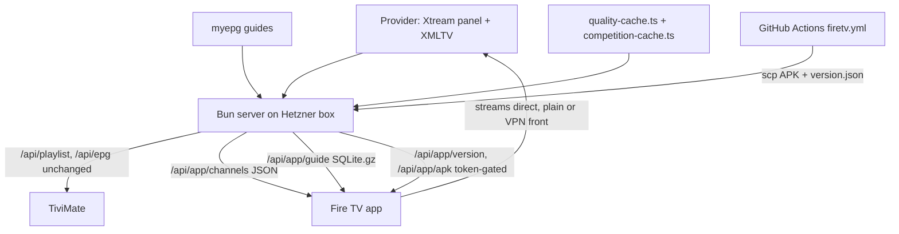
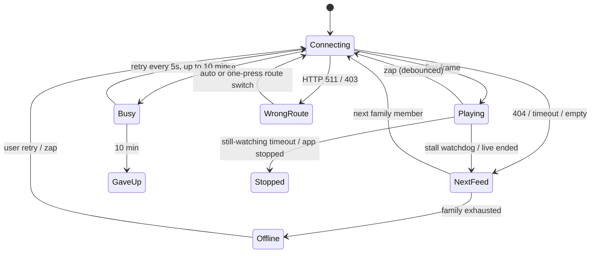

# Fire TV Player App - Plan

## Goal Capsule

- **Objective:** Watching live TV on the user's Fire TV Stick 4K (2nd gen) needs no paid player: an own app opens to the last channel, zaps, finds events and shows several matches at once at least as smoothly as TiviMate does today.
- **Means:** A native Kotlin app, sideloaded and self-updating, on top of a compact feed this repo's server builds from its existing curation (KTD1, KTD3).
- **Product authority:** The user (sole user of the app). The Product Contract wins on behavior; KTDs win on mechanism within it.
- **Execution profile:** Deep, phased. Phase A (device spike, server feed, distribution) lands before the app UI; multi-view's tile count comes from U1's measurement, not from this plan.
- **Stop conditions:** Stop and ask if U1 shows the stick cannot decode two live HD streams at once, or the provider refuses a second simultaneous stream from the stick (HTTP 458) on either route (multi-view would need a different shape), or if any change would alter `/api/playlist` or `/api/epg` output (R2).
- **Finishing:** The implementer builds, verifies on the real stick over adb, commits and pushes to `master` per the user's always-commit-and-push rule; the APK workflow then ships updates.
- **Open blockers:** None.

---

## Product Contract

Product Contract preservation: changed: R4, R11, R14, R15, AE3, Key Decisions (multi-view moved into v1), Scope Boundaries; added R17–R26 — the user expanded v1 during planning (multi-view, backup feed, quality badges, Live now row) and confirmed research-driven clarifications (route auto-detect, three error classes, update row, still-watching, search rules, 50Hz).

### Summary

A small native Fire TV app, sideloaded onto the Fire TV Stick 4K, that plays the curated live channels from this repo's server. It opens straight into the last-watched channel and offers a grouped channel list with now/next and quality badges, a "Live now" row of current matches, a per-channel schedule, event search, and 2–4-tile multi-view. Channels fail over to a backup feed of the same channel, and the app updates itself from the server, so a push to `master` reaches the TV without adb.

### Problem Frame

The user watches live TV through TiviMate on a Fire TV Stick 4K, fed by this repo's trimmed playlist and EPG. They do not want to pay for TiviMate, but the parts they rely on are speed (startup, zapping, scrolling), finding an event across channels, multi-view, and switching between a plain and a VPN playlist — and the last two are Premium-only features. They mostly browse the channel list with now/next, and sometimes search for an event to see which channels' EPG shows it. Catch-up, recording and profiles are unused. The server already curates channels, 🏆 competition groups, measured feed quality and an EPG scoped to the kept channels, so most of the hard data work is done before the device sees anything.

### Key Decisions

- **Own native app over forking an open-source player or using a free player with server-side groups.** The server already removed the hard part (huge playlist/EPG), so a fresh app stays small and fast. (session-settled: user-directed — chosen over forking an open-source player and over a free player plus server groups: smallest fast client on top of existing server curation)
- **Channel list with now/next, no EPG grid in v1.** The user mostly browses the list; the grid is the most expensive piece to make smooth. Governs R5, R6. (session-settled: user-approved — chosen over a full TV-guide grid: list is how the user finds things today)
- **The server prepares a compact feed for the app; the TiviMate feeds stay unchanged.** Keeps the stick's work minimal and TiviMate usable as a fallback. Governs R1, R2.
- **Both provider routes, picked automatically from the stick's VPN state.** The user switches between plain and VPN playlists today and runs the VPN as an app on the stick. Governs R4. (session-settled: user-directed — chosen over plain-only or VPN-only, and over a manual-only toggle: the VPN runs on the stick, so the app can detect it)
- **Self-update is in v1.** Sideloaded apps don't update themselves; this matches the push-to-deploy habit. Governs R15, R16. (session-settled: user-directed — chosen over leaving updates out of v1: user asked to keep it)
- **Multi-view, backup feed, quality badges and the Live now row are in v1; 4K movies stay in v2.** The user asked for a more ambitious v1. Governs R11, R17–R22. (session-settled: user-directed — chosen over multi-view in v2 and over reminders/auto-tune: user picked these extras and declined reminders)
- **No favourites.** The server's groups already play that role.

### Requirements

**Data and setup**

- R1. The app gets channels, groups, quality and guide data from this repo's server in a form made for it, already limited to the curated live channels.
- R2. The existing `/api/playlist` and `/api/epg` feeds keep working unchanged for TiviMate.
- R3. First-time setup never requires typing a long URL or token with the remote.
- R4. The provider route (plain or VPN front) follows the stick's VPN state automatically, with a manual override in the player's quick panel.
- R25. Launch plays from data cached on the device and never waits on the server; a failed or malformed refresh keeps the previous data.

**Browsing**

- R5. The channel list shows the server's groups in server order, and each channel row shows its logo, name, current programme with progress, and the next programme.
- R6. Opening a channel's details shows its schedule from now through the end of the available EPG.
- R7. Event search matches programme titles across all channels anywhere in a word (e.g. "arse" finds Arsenal, "ball" finds football), ignoring case and accents, and lists results live-now first, then upcoming up to about 24 hours ahead.
- R8. Picking a live search result tunes to that channel; an upcoming result shows its channel and start time.
- R21. Each channel row shows a quality badge (4K, FHD, 50fps, Atmos) taken from measured feed quality; a feed never measured shows no badge.
- R22. A "Live now" row at the top of the channel list shows each match currently airing on a 🏆 competition channel once, tuning its best feed.
- R26. Event search shows one row per channel per programme, excludes guide entries that only repeat the channel's own name, and lists event/PPV slot channels matched by name in a separate section after programme results.

**Playback**

- R9. On launch the app plays the last-watched channel without passing through any menu.
- R10. In the full-screen player, D-pad up/down zaps to the previous/next channel in the current group, OK opens the channel list over the still-playing video, Menu opens a quick panel, and Back jumps to the previously watched channel (Back closes an open overlay first).
- R11. The player is built so seekable VOD playback can be added later without a rewrite.
- R12. Switching channels never leaves the previous stream holding a provider connection.
- R13. The audio track can be switched from the quick panel when a feed carries more than one track.
- R14. When a stream fails or stalls, the app retries on its own, and if it can't recover it says which of three causes applies: the connection is busy, the provider route is wrong for the current VPN state (with a one-press switch), or the channel is offline.
- R20. When a channel stalls or goes offline, the app switches to another feed of the same channel before reporting it offline.
- R23. The TV's refresh rate follows the stream's frame rate (e.g. 50Hz for European sports) where the TV supports it.
- R24. After 4 hours without a remote press, the app asks "Still watching?" and stops all streams if nobody answers within a minute.

**Multi-view**

- R17. From the quick panel the user can open multi-view with the current channel, add channels from the channel list, and show 2 to 4 live tiles at once, up to what the stick can decode.
- R18. Sound follows the selected tile; the D-pad moves the selection, OK makes the selected tile full-screen, and Back leaves multi-view keeping the selected tile.
- R19. Tiles play an HD feed of each channel rather than its 4K feed, so several tiles fit within the stick's decoders.

**Updates**

- R15. The app checks the server for a newer version at launch and on resume, and offers it as an "Update ready" row in the channel list that installs through the system installer when picked.
- R16. An update never interrupts a playing stream on its own.

### Key Flows

- F1. Launch and watch
  - **Trigger:** User opens the app.
  - **Steps:** Last channel starts playing from cached data (R9, R25); in parallel the app refreshes the feed and guide and checks for an update (R15).
  - **Outcome:** Picture on screen with no navigation.
- F2. Browse and zap
  - **Trigger:** User presses OK in the player.
  - **Steps:** Channel list opens over video at the current channel (R5, R21, R22); user moves through groups and picks a channel; or zaps with up/down without opening the list (R10).
  - **Outcome:** New channel playing; Back returns to the previous one.
- F3. Find an event
  - **Trigger:** User opens search and types part of a team, player or event name.
  - **Steps:** Results appear live-first (R7, R26); user picks one (R8).
  - **Outcome:** Live result plays; upcoming result shows when and where it airs.
- F4. Multi-view
  - **Trigger:** User picks multi-view in the quick panel.
  - **Steps:** Current channel becomes the first tile; user adds channels from the list (R17); D-pad selects a tile and its sound plays (R18).
  - **Outcome:** OK makes the selected tile full-screen; Back leaves multi-view on the selected tile.

### Acceptance Examples

- AE1. **Covers R7, R8, R26.** **Given** Arsenal plays now on two channels and later on one, **when** the user searches "arse", **then** the two live channels list first, the later one after with its start time, and picking a live one plays it.
- AE2. **Covers R10.** **Given** the user watched channel A then switched to B, **when** they press Back in the full-screen player, **then** A plays; **given** the channel list overlay is open, Back closes it instead.
- AE3. **Covers R15, R16.** **Given** a newer version is on the server and a stream is playing, **then** no installer appears on its own; an "Update ready" row shows in the channel list, and picking it opens the system installer.
- AE4. **Covers R14.** **Given** another device holds the account's connection, **when** the user tunes a channel, **then** the app reports the connection is busy and keeps retrying rather than calling the channel broken.
- AE5. **Covers R4, R14.** **Given** the stick's VPN is on but the manual override forces the plain route, **when** a stream returns HTTP 511, **then** the app says the route is wrong and one press switches to the VPN route and retunes.
- AE6. **Covers R20.** **Given** a channel has an FHD and an HD feed and the FHD feed stops delivering data, **then** playback continues on the HD feed without the user doing anything.
- AE7. **Covers R17, R18, R19.** **Given** the user is in a two-tile multi-view with the right tile selected, **when** they press OK, **then** the right tile's channel plays full-screen and the other tile's stream stops.
- AE8. **Covers R9, R25.** **Given** the last-watched channel's 🏆 group no longer exists after a refresh, **when** the app launches, **then** it plays the same stream from its home group.

### Success Criteria

- Cold start to picture, channel zap to picture, and channel-list scrolling are at least as fast as TiviMate on the same Fire TV Stick 4K and the same channels, measured on the device.
- After a week of normal use, the user has not needed to open TiviMate for live viewing.

### Scope Boundaries

**Deferred for later (v2)**

- 4K movies (VOD) browsing and playback with seek and resume.

**Outside this product's identity**

- Catch-up, recording, profiles, reminders or auto-tune for upcoming events.
- EPG grid view.
- Subtitles and aspect-ratio controls.
- Favourites.
- Distribution through an app store or use by anyone but the user.

**Considered and not built**

- Routing streams through the server to share one upstream connection: the provider refuses streams from the box's IP, and same-device multi-view already works. Would change if the provider started enforcing one stream per IP.
- Matching Arabic-script titles from Latin queries: needs transliteration; revisit if beIN Arabic matches are missed in practice.
- Server-side "TV is watching" heartbeat for the nightly probe: R14's busy retry plus R24 already keep the probe and the TV from blocking each other for long; revisit if nights still lose probes.
- Self-update without the system confirm dialog: impossible on Fire OS 8 (needs API 31).
- Remembering the audio-track choice per channel: R13 only asks for switching; add it if re-picking commentary on the same channel becomes a nuisance.
- Token in a request header instead of the query string: `cached()` keys on the URL and serves hits before auth, so a header would need an auth-before-cache change in `server.ts`; the app sends no Referer and the server logs nothing, so the query string stays.

#### Deferred to Follow-Up Work

- `/api/proxy` hardening (found during security review, unrelated to this app): it skips the token on a client-supplied `Sec-Fetch-Site: same-origin` and trusts `x-forwarded-host`.
- Server-resized logos (small WebP at one size): only if U13 shows logo decoding costs list smoothness.

### Dependencies / Assumptions

- The provider allows several simultaneous streams from the same device even though the panel reports `max_connections: 1` (TiviMate multi-view works for the user); a second IP while watching gets HTTP 458.
- The user's stick is a 2nd-gen Fire TV Stick 4K or 4K Max: Fire OS 8, Android 11, API 30.
- Fire OS lets the app install its own updates after the user grants it the install-unknown-apps permission once; each install shows a system confirmation.
- The server box stays reachable from the TV through the existing Cloudflare Tunnel hostname.

### Outstanding Questions

**Deferred to Planning**

- Concrete target numbers for the success criteria, from a TiviMate baseline measured on the stick (U13 measures both).

### Sources / Research

- `api/playlist.ts`, `api/epg.ts` — token-gated M3U and XMLTV feeds used by TiviMate; `api/epg.ts` reuses guide downloads for 6h.
- `api/_lib.ts` — `buildM3U` writes direct provider stream URLs; `buildEventEpg` scopes the guide to curated channels, gives PPV slots and uncovered channels name-as-title blocks from -1h to +24h, and fixes the Qatari 3h clock; `withCompetitionGroups` copies channels into 🏆 groups keeping `streamId` and `tvgId`; `QUALITY` from `api/quality-cache.ts` drives ordering.
- `server.ts` — routes, in-memory `cached()` by Cache-Control, `/api/proxy` bypasses the cache; `deploy/sync.sh` and `.github/workflows/deploy.yml` — push-to-deploy with `rsync --delete` of `dist/`.

---

## Planning Contract

### Key Technical Decisions

- KTD1. **Kotlin, Media3 ExoPlayer 1.11.x, Compose for TV (`androidx.tv:tv-material` 1.1), minSdk 30.** Media3 is the engine TiviMate-class players use and plays progressive MPEG-TS; Compose for TV replaced the deprecated Leanback. minSdk 30 matches the user's Fire OS 8 stick and unlocks `Surface.setFrameRate` (R23). Use plain `androidx.compose.foundation` lazy lists (the `TvLazy*` lists were removed), never mix `material3` with `tv-material`. Keep a RecyclerView fallback in mind if U13 measures Compose jank on the stick.
- KTD2. **The app lives in `firetv/` in this repo with its own workflow.** `deploy.yml` ignores `firetv/**` so app pushes never restart the server (a restart empties its cache); `.github/workflows/firetv.yml` builds only on `firetv/**` changes.
- KTD3. **Two app endpoints: a small JSON channel feed and a prebuilt SQLite guide file.** `/api/app/channels` carries groups, channels, quality badges, feed families and both provider hosts so the app builds stream URLs itself and a route switch needs no refetch (R4). `/api/app/guide` serves a gzip SQLite file built with `bun:sqlite`, so the stick opens it with no parsing (research: JSON/XMLTV parse of ~100k programmes costs seconds on stick-class CPUs). Both go through `server.ts` `cached()`; the guide is built by parsing `buildEventEpg`'s own XMLTV output, so it carries the same corrections TiviMate sees and `/api/epg` output stays byte-identical (R2).
- KTD4. **Guide rows mark synthetic and match programmes on the server.** A row whose title equals its channel name with the group as description is flagged synthetic (name-as-title); `couldBeLiveMatch` flags matches for the Live now row. Search (R7, R26) runs `LIKE` on a server-normalized title column (lowercased, accents stripped), since FTS prefix queries cannot match inside a word; U10 measures it on the stick.
- KTD5. **Channel identity is (streamId, group) with a fallback chain.** 🏆 copies share `streamId` and `tvgId` with their originals and the list changes every 30 min, so "last", "previous" and zap context use the pair. Fallback when missing: same `streamId` in its home (non-🏆) group → best feed of the same family → open the channel list with no autoplay. Governs R9, R10, AE8.
- KTD6. **Feed families come from the server, keyed by home group plus `chanKey(name)`.** tvg-id does not identify a channel: the provider stamps `SkySportsNews.uk` on a Main Event feed and gives TNT Sports 1 different ids per feed, which is why `buildEventEpg` already keys siblings by `group|chanKey(name)`. Each channel carries that family key and its rank within the family in server quality order, with 🏆 copies of the same `streamId` never counted as a backup. Each channel also carries its probed height (null when unmeasured) and its name-marker quality tier `q`. Backup failover (R20) walks down the family; multi-view tiles (R19) take the highest-ranked member with a probed height of 1080 or less, else one with `q` below 5, else the top member.
- KTD7. **One pool of long-lived ExoPlayer instances, reused across zaps.** Single view uses one player; multi-view adds players up to the tile cap from U1. Each zap is stop → set item → prepare on the same player, with a TS-only extractor, small start buffers, MIME hint `video/mp2t`, cleartext and cross-host redirects allowed (streams 302 to http-only nodes), and one shared HTTP client. SurfaceView per tile; TextureView costs a GPU copy per frame at 50fps.
- KTD8. **Stream errors map to three classes by HTTP status.** 458 → busy: retry every 5s for up to 10 min with a visible message (lets the TV win the slot back from the nightly probe). 511 (plain front over VPN) and 403 (VPN front without VPN) → wrong route: with no manual override, re-read the VPN state, switch and retune once (the automatic route was stale); with an override, or if the switch fails again, prompt with a one-press switch. 404, empty body, timeouts and stalls → try the next family feed (KTD6), then report offline. 5xx → exponential backoff to 8s. A watchdog treats buffering beyond a few seconds, a position that stops advancing, or a live `STATE_ENDED` as a stall and hands off to the next family feed (R20); a channel with a single feed re-prepares it instead. A quiet retry after any route or IP change absorbs the panel's ~5s connection-release lag before calling the slot busy.
- KTD9. **Rapid zaps are debounced without delaying a single zap.** The banner updates on every key press from local data. A press with no zap in the previous ~300ms tunes at once; during a burst only the channel the user rests on is tuned, so at most the first and last channel of a burst open a connection.
- KTD10. **The app has its own token, baked in at build; the APK is private.** The repo is public, `dist/` is served without a token, and the token leads to provider credentials. All `/api/app/*` routes accept any token in a comma-separated `APP_TOKENS` on the box (not `PLAYLIST_TOKEN`; entries trimmed, empty ones dropped, and no entries left means every request is refused), so either can be rotated alone, and a rotation ships a build with the new token before the old one is removed, keeping self-update alive. The APK and `version.json` live in `/opt/iptv-preview/app/` (outside `dist/`; `rsync --delete` only prunes the directories it lists, which is why `.env` survives) and are served from fixed paths by `/api/app/version` and `/api/app/apk` (no file extension, so Cloudflare does not cache it), checking the token before the file, with `Cache-Control: no-store` and no CORS header. Channel and guide JSON send `private, s-maxage=…` so only the server's own cache keeps them. CI never uploads the APK as a GitHub artifact or release (artifacts in a public repo are readable by any signed-in GitHub user). The app talks to its server over https only: a network security config allows cleartext for the provider stream hosts but not for the server's domain.
- KTD11. **Release-signed from day one; versionCode from the commit count; the updater only installs its own package.** The keystore lives in GitHub secrets (and a local copy outside the repo for the first adb sideload) and the first install uses the release build, or the first self-update fails on signature mismatch. versionCode is `git rev-list --count HEAD` in both local and CI builds, so an adb-installed local build and the CI build of the same commit match and later commits are always higher. Before opening a `PackageInstaller` session the app reads the downloaded APK's package info and refuses it unless the package name matches its own, so a tampered server can't push a different app through a habitual Install press; the system installer already rejects a different signing certificate or a downgrade for the same package. Signing values and the app token are read only from environment variables or `~/.gradle/gradle.properties`, never from a file inside the repo.
- KTD12. **Audio decoders are measured before adding FFmpeg.** U1's diagnostics list the stick's MP2/AC3/E-AC3 decoders; the Media3 FFmpeg extension (community AAR or CI-built) is added only if a decoder the feeds use is missing.
- KTD14. **The APK workflow is locked down because it holds the signing key.** Every action pinned by SHA (including `checkout`), Gradle wrapper checksum validated, each secret given only to the step that needs it (tests run with none), and the APK copied with a dedicated SSH key whose forced command can only write `/opt/iptv-preview/app/`, not the root deploy key. Only dependency caches are used, never Gradle's build cache or build directories (they contain the baked token), and the workflow never runs on `pull_request_target`.
- KTD13. **Frame-rate matching switches the display mode through `preferredDisplayModeId`.** A 60→50Hz HDMI change is never seamless and API 30 has no opt-in to force one through `Surface.setFrameRate`, so the app picks the `Display.Mode` with the current resolution and the stream's frame rate and sets it on the window, as Amazon's Fire TV HDMI mode-switch guide documents. It applies once the zap debounce settles (never mid-burst) and only when the rate differs from the current mode; `Surface.setFrameRate` stays as a secondary hint.

### High-Level Technical Design

Data flow from provider to TV:



Stream session state per player (single view and each tile):



Remote key map (full-screen player): Up/Down zap within group; OK channel list overlay; Menu quick panel (audio track, route override, multi-view, diagnostics); Back previous channel or close overlay. In the overlay: Left to groups column, Right on a row to details/schedule, search as the first row of the groups column, "Update ready" row at the top when present.

### Output Structure

```
firetv/
  settings.gradle.kts
  build.gradle.kts
  gradle/libs.versions.toml
  app/
    build.gradle.kts
    src/main/AndroidManifest.xml
    src/main/java/com/mohamed3on/iptv/
      App.kt, MainActivity.kt
      data/      Feed.kt, FeedSync.kt, GuideDb.kt, ChannelIdentity.kt, Route.kt
      player/    PlayerPool.kt, StreamErrors.kt, StreamSession.kt, AudioTracks.kt, FrameRate.kt, IdleWatch.kt
      ui/        PlayerScreen.kt, KeyMap.kt, ChannelOverlay.kt, Details.kt, Search.kt, QuickPanel.kt, MultiView.kt
      update/    Updater.kt
      diag/      Diagnostics.kt
    src/test/java/com/mohamed3on/iptv/  (JVM unit tests per unit)
api/
  app.ts            (channels, guide, version, apk handlers)
  _app-feed.ts      (feed + guide builders)
  _app-feed.test.ts
.github/workflows/firetv.yml
```

### Assumptions

- Building `/api/app/guide` from the XMLTV string costs a few seconds per 15-minute rebuild on the box, acceptable behind `cached()`.
- `LIKE` over ~100k normalized titles in SQLite returns within the search debounce on the stick; U10 confirms.

---

## Implementation Units

| U-ID | Title | Files touched | Depends on |
|---|---|---|---|
| U1 | App scaffold + device capability spike | `firetv/**`, `Diagnostics.kt` | — |
| U2 | App channel feed endpoint | `api/app.ts`, `api/_app-feed.ts`, `server.ts` | — |
| U3 | App guide database endpoint | `api/_app-feed.ts`, `api/epg.ts` | U2 |
| U4 | Private app distribution routes | `api/app.ts`, `server.ts`, `deploy.yml` | U2 |
| U5 | APK build-and-ship workflow | `.github/workflows/firetv.yml`, `firetv/app/build.gradle.kts` | U1, U4 |
| U6 | Data layer: sync, cache, identity, route | `firetv/.../data/*` | U1, U2, U3 |
| U7 | Player engine: pool, errors, failover | `firetv/.../player/*` | U1, U6 |
| U14 | Audio tracks, frame-rate matching, still-watching | `AudioTracks.kt`, `FrameRate.kt`, `IdleWatch.kt` | U7 |
| U8 | Full-screen player, keys, quick panel | `PlayerScreen.kt`, `KeyMap.kt`, `QuickPanel.kt` | U7, U14 |
| U9 | Channel list overlay, Live now, details | `ChannelOverlay.kt`, `Details.kt` | U6, U8 |
| U10 | Event search | `Search.kt`, `GuideDb.kt` | U6, U9 |
| U11 | Multi-view | `MultiView.kt`, `PlayerPool.kt` | U7, U9 |
| U12 | Self-update client | `update/Updater.kt` | U4, U5, U9 |
| U13 | Performance pass and TiviMate baseline | build config, baseline profile | U8–U11, U14 |

### Phase A — Foundation

### U1. App scaffold + device capability spike

**Goal:** A release-signed, sideloadable empty app on the stick with a diagnostics screen that answers the hardware questions the rest of the plan depends on.
**Requirements:** R17 (tile cap), R13 (decoders), KTD1, KTD11, KTD12.
**Dependencies:** none.
**Files:** `.gitignore`, `firetv/settings.gradle.kts`, `firetv/build.gradle.kts`, `firetv/gradle/libs.versions.toml`, `firetv/app/build.gradle.kts`, `firetv/app/src/main/AndroidManifest.xml`, `firetv/app/src/main/res/xml/network_security_config.xml`, `firetv/app/src/main/java/com/mohamed3on/iptv/App.kt`, `MainActivity.kt`, `diag/Diagnostics.kt`.
**Approach:**
0. First, before any build: ignore `*.jks`, `*.keystore`, `local.properties`, `keystore.properties`, `.gradle/` and `firetv/**/build/`; wire signing and the app token from env or `~/.gradle/gradle.properties` only (KTD11).
1. Scaffold with AGP 9.5, Gradle 9.6, JDK 17, compileSdk 36, minSdk 30; Media3 1.11.x and tv-material 1.1 in the version catalog.
2. Manifest: leanback feature (not required), touchscreen not required, `LEANBACK_LAUNCHER` + `LAUNCHER`, 320×180 banner, `INTERNET`, `ACCESS_NETWORK_STATE`, `REQUEST_INSTALL_PACKAGES`, a network security config allowing cleartext except for the server's domain (KTD10), `configChanges` covering display-mode changes.
3. Diagnostics screen (reachable from the quick panel later, launch screen for now): Fire OS version/model, `getMaxSupportedInstances` for AVC and HEVC, presence of MP2/AC3/E-AC3/E-AC3-JOC decoders, HDMI audio capabilities, supported display modes.
4. Spike: hard-code 2, 3, then 4 provider stream URLs (HD feeds) and play them simultaneously in SurfaceViews, on both the plain and the VPN route; record each stream's HTTP status and which counts hold 50fps without dropped frames.
5. Diagnostics also report the current display mode's alternative refresh rates and the supported 50Hz modes (KTD13).
**Execution note:** This is a device spike; verify on the stick over adb, not with unit tests. Record the measured tile cap and decoder list in the PR description; they set U11's cap and KTD12's outcome.
**Test scenarios:** Test expectation: none -- scaffold and measurement spike; its output is the recorded numbers.
**Verification:** `git status` after a release build shows no keystore, `BuildConfig` or build output; the release-signed APK installs over adb and launches from the Fire TV launcher; diagnostics show decoder counts; the measured simultaneous-stream count is written down. If fewer than 2 HD streams decode together, stop (Goal Capsule).

### U2. App channel feed endpoint

**Goal:** `/api/app/channels?t=TOKEN` returns the compact JSON the app needs, without touching the TiviMate feeds.
**Requirements:** R1, R2, R4, R21, R22, KTD3, KTD6.
**Dependencies:** none.
**Files:** `api/app.ts`, `api/_app-feed.ts`, `api/_app-feed.test.ts`, `server.ts`.
**Approach:**
1. Build from `withCompetitionGroups(await fetchCuratedChannels(cfg, false))` (live only), as `api/playlist.ts` does, so curation, 🏆 groups and ordering match the M3U exactly.
2. Emit: groups in order; per channel `streamId`, name, logo, group, tvg-id, `isEventSlot`, home group (only when that group is in the feed; PL-abroad channels appear only in 🏆 groups and get none), family key, rank, probed height and `q` (KTD6), and a badge from `QUALITY` (4K/FHD/50fps/Atmos; none when unmeasured, per R21).
3. Emit provider route info once: plain host, VPN host (the `VPN_HOST` constant in `api/playlist.ts`, moved to `_lib.ts` so both share it), user, pass. Stream URL shape stays `host/live/user/pass/<id>.ts` as in `buildM3U`.
4. Token gate against `APP_TOKENS` (KTD10); register in `server.ts` `routes` so `cached()` applies, with `Cache-Control: private, s-maxage=1800, stale-while-revalidate=3600` and no CORS header. The token stays in the query string, because `cached()` returns hits before the handler runs and the full URL is the cache key.
**Patterns to follow:** `api/playlist.ts` handler shape and error handling (502 with message); `api/_lib.test.ts` style with `bun:test`.
**Test scenarios:**
- A channel whose home group is in the feed and that is copied into a 🏆 group appears twice with the same `streamId`, different groups, and the original's group as home group.
- "VIP: TNT SPORTS 1 RAW" (`TNTSport1.uk`) and "NOW: TNT SPORT 1 HD" (`tntsports1.uk`) in one group share a family, ranked in server order.
- A Sky Sports Main Event feed carrying `SkySportsNews.uk` is not in Sky Sports News's family.
- A PL-abroad channel appears only in its 🏆 group and carries no home group.
- A channel with a `QUALITY` entry of 3840×2160 gets the 4K badge; 1920×1080 at 50fps gets FHD and 50fps; an `atmos` entry adds Atmos; a channel absent from `QUALITY` gets no badge.
- A request without a token, or with `PLAYLIST_TOKEN` instead of an app token, returns 403.
- Through `server.ts`: after a request with a valid token warms the cache, the same path without the token still returns 403.
- With `APP_TOKENS=old,new`, both tokens return the feed.
- With `APP_TOKENS=new,` a request with an empty `?t=` returns 403; with `APP_TOKENS` unset every request returns 403.
- `buildM3U` output for the same channels is unchanged by the `VPN_HOST` move (R2).
**Verification:** `bun test` passes; on the box, `/api/app/channels?t=…` returns JSON whose channel count matches the playlist's live entries.

### U3. App guide database endpoint

**Goal:** `/api/app/guide?t=TOKEN` serves a gzip SQLite file of the guide the app opens directly.
**Requirements:** R1, R2, R5, R6, R7, R22, R26, KTD3, KTD4.
**Dependencies:** U2.
**Files:** `api/_app-feed.ts`, `api/_app-feed.test.ts`, `api/epg.ts`, `api/app.ts`.
**Approach:**
1. Extract the guide-download reuse and `buildEventEpg` call from `api/epg.ts` into a shared function both handlers call, keeping `/api/epg` output identical.
2. Parse the XMLTV string into rows: tvg-id, start, stop, title, normalized title, description, `synthetic` (title equals channel name and description equals group), `match` (`couldBeLiveMatch`).
3. Write rows into an in-memory `bun:sqlite` database with an index on (tvg-id, start) and on start; drop rows that ended more than 2h ago; serialize, gzip, serve with `Cache-Control: private, s-maxage=900` (KTD10).
**Execution note:** Add a characterization test that pins `/api/epg`'s XML for a fixed channel set and guide before extracting the shared function.
**Patterns to follow:** existing `buildEventEpg` tests in `api/_lib.test.ts`; `GUIDE_TTL` reuse in `api/epg.ts`.
**Test scenarios:**
- `/api/epg` XML for a fixed fixture is byte-identical before and after the extraction.
- A PPV slot produces 25 rows flagged synthetic; a regular channel with real programmes produces non-synthetic rows.
- An uncovered regular channel's name-as-title rows are flagged synthetic.
- "Arsenal v Chelsea" is flagged match; "Sky Sports News" is not.
- "Bayern München" is stored with normalized title "bayern munchen".
- A programme that ended 3 hours ago is absent; one that ended 1 hour ago is present.
**Verification:** `bun test` passes; the served file opens with `sqlite3` after gunzip and its row count is in the expected range for 2 days of guide.

### U4. Private app distribution routes

**Goal:** The app can fetch its version manifest and APK from the box behind the token, and app pushes don't redeploy the server.
**Requirements:** R15, KTD2, KTD10.
**Dependencies:** U2.
**Files:** `api/app.ts`, `api/_app-feed.test.ts`, `server.ts`, `.github/workflows/deploy.yml`, `README.md`.
**Approach:**
1. `/api/app/version` serves `/opt/iptv-preview/app/version.json` (`versionCode`, `versionName`, `sha256`); `/api/app/apk` streams the APK. Both use fixed paths (never built from the request), check `APP_TOKENS` before touching the file, bypass `cached()` like `/api/proxy`, send `no-store`, and return 404 when the files are absent (KTD10).
2. Add `firetv/**` to `deploy.yml` `paths-ignore`.
3. On the box: `APP_TOKENS` in `.env`, and the dedicated APK-copy key in the `iptv` user's `authorized_keys` (never root's) as `restrict,command="rrsync -wo /opt/iptv-preview/app"`, so it can only write that directory and cannot forward ports (KTD14).
4. Document the `app/` directory, the endpoints, `APP_TOKENS` and the token-rotation steps in the README hosting section.
**Test scenarios:**
- Without the token both routes return 403.
- With the token and no files present, both return 404.
- With a fixture `version.json`, `/api/app/version` returns it verbatim with `Cache-Control: no-store`.
- Without a token and no files present, the response is 403, not 404 (the token is checked first).
**Verification:** `bun test` passes; after deploy, `/api/app/version?t=…` returns 404 until U5 ships the first build.

### U5. APK build-and-ship workflow

**Goal:** A push touching `firetv/**` builds a release-signed APK and installs it on the box for the app to find.
**Requirements:** R15, KTD2, KTD10, KTD11, KTD14.
**Dependencies:** U1, U4.
**Files:** `.github/workflows/firetv.yml`, `firetv/app/build.gradle.kts`.
**Approach:**
1. Trigger on push to `master` with `paths: firetv/**`, plus `workflow_dispatch`.
2. JDK 17 + Gradle setup with SHA-pinned actions and wrapper validation (KTD14).
3. Run JVM unit tests with no secrets in the environment.
4. `assembleRelease` is the only step that receives `ANDROID_KEYSTORE_B64`, `KEYSTORE_PASSWORD`, `KEY_ALIAS`, `KEY_PASSWORD`, `APP_SERVER_URL` and `APP_TOKEN`; `versionCode` from the commit count, with checkout `fetch-depth: 0` (KTD11).
5. The copy step alone receives `APP_DEPLOY_SSH_KEY` (the restricted key, not `HETZNER_SSH_KEY`) and `SERVER_HOST`; it uploads the APK with rsync through that key, then `version.json` with its sha256 in a second rsync call (rsync writes a temp file and renames), so the app never sees a manifest for a half-copied APK.
6. No artifact upload, no release, no build cache (KTD10, KTD14).
**Patterns to follow:** `.github/workflows/deploy.yml` SSH and pinned-action conventions.
**Test scenarios:** Test expectation: none -- CI configuration; proven by a workflow run.
**Verification:** A test push builds green and its log shows no token or URL in clear; `/api/app/version?t=…` then returns the new `versionCode`; the APK downloaded from `/api/app/apk` installs over the U1 build without a signature error.

### Phase B — App

### U6. Data layer: sync, cache, identity, route

**Goal:** The app always has channels and guide on disk, knows which channel is "last" and "previous", and builds the right stream URL for the current route.
**Requirements:** R1, R3, R4, R9, R25, AE5, AE8, KTD3, KTD5, KTD6.
**Dependencies:** U1, U2, U3.
**Files:** `firetv/app/src/main/java/com/mohamed3on/iptv/data/Feed.kt`, `FeedSync.kt`, `GuideDb.kt`, `ChannelIdentity.kt`, `Route.kt`; tests `src/test/.../ChannelIdentityTest.kt`, `RouteTest.kt`, `FeedSyncTest.kt`.
**Approach:**
1. `FeedSync` fetches the channel JSON and guide file with ETag, writes to temp files, validates (JSON parses, SQLite opens, non-empty), then renames atomically; any failure keeps the old files (R25). Refresh at launch, every 30 min for channels and 3h for the guide, and on resume when older than 1h.
2. First run (no cached feed): a full-screen "Loading channels" state until the first validated sync; on failure it names the cause (offline or server rejected) with Retry; on success with no last channel it opens the channel overlay at the first group.
3. Persist last and previous identities (KTD5) and the route choice.
4. `Route` reads `NetworkCapabilities.TRANSPORT_VPN` via a network callback; the route choice is Auto (default), Plain or VPN; the effective route is the explicit choice, else the VPN state (R4). The wrong-route one-press switch (KTD8) applies for the session only and never writes the persisted choice.
5. Stream URL = route host + `/live/user/pass/<streamId>.ts`.
**Test scenarios:**
- Covers AE8. Last identity (101, "🏆 Premier League") with no such group in the new feed resolves to (101, its home group).
- Last streamId gone entirely resolves to the top-ranked member of its family; family gone resolves to "open list, no autoplay".
- A refresh returning HTML (a Cloudflare challenge page) is rejected and the old feed stays.
- A guide download truncated mid-file fails validation and the old guide stays.
- VPN on, no override → VPN host; VPN on, override plain → plain host; VPN off, no override → plain host.
- Previous-channel toggle: watching A then B then A makes B the previous channel.
- No cached feed and the server unreachable → first-run error state with Retry, no crash and no empty list.
**Verification:** Unit tests pass; on the stick with the network unplugged, a relaunch still lists channels and attempts the last one.

### U7. Player engine: pool, errors, failover

**Goal:** Fast, leak-free playback that recovers by itself and reports busy, wrong route or offline correctly.
**Requirements:** R11, R12, R14, R20, AE4, AE5, AE6, KTD7, KTD8, KTD9.
**Dependencies:** U1, U6.
**Files:** `firetv/app/src/main/java/com/mohamed3on/iptv/player/PlayerPool.kt`, `StreamErrors.kt`, `StreamSession.kt`; tests `src/test/.../StreamErrorsTest.kt`, `StreamSessionTest.kt`.
**Approach:**
1. `PlayerPool` owns long-lived ExoPlayer instances (one now; more for U11) with the KTD7 configuration and a shared data source factory. Release all in `onStop`, recreate on `onStart`.
2. `StreamErrors` maps a load error to busy / wrong route / next feed / backoff per KTD8 as a pure function.
3. `StreamSession` is the per-player state machine in the High-Level Technical Design: debounced tune (KTD9), watchdog, retry timers, family failover (R20), cancel-on-zap so no timer or connection outlives a zap (R12).
**Execution note:** Implement `StreamErrors` and `StreamSession` test-first with a fake clock and fake player; they carry the failure behavior the stick can't easily reproduce on demand.
**Test scenarios:**
- Covers AE4. HTTP 458 → busy, retried every 5s; still busy at 10 min → gave-up state with a retry action.
- A 458 within 5s after a route change is retried quietly once before entering busy.
- HTTP 511 with VPN on, no override and the plain route in use → switch to the VPN host and retune once; 511 again → wrong-route prompt.
- Covers AE5. HTTP 511 with VPN on and the override forcing plain → wrong-route prompt with no automatic switch; pressing it switches to the VPN host and retunes.
- HTTP 403 on the VPN host with VPN off → wrong route.
- Covers AE6. FHD feed times out → session tunes the next family member; all members fail → offline.
- HTTP 503 → retries after 1s, 2s, 4s, 8s, 8s.
- Five zaps within 300ms tune the first and the last channel only; the middle three open no connection.
- A single isolated zap tunes with no added delay.
- A zap during a busy retry cancels the pending retry.
- Live `STATE_ENDED` triggers the stall path, not "finished".
**Verification:** Unit tests pass; on the stick, pulling the network mid-stream recovers when it returns, and zapping 20 times in a row never produces a 458.

### U14. Audio tracks, frame-rate matching, still-watching

**Goal:** The playback extras around the engine: commentary-track choice, 50Hz output and the idle stop.
**Requirements:** R13, R23, R24, KTD12, KTD13.
**Dependencies:** U7.
**Files:** `firetv/app/src/main/java/com/mohamed3on/iptv/player/AudioTracks.kt`, `FrameRate.kt`, `IdleWatch.kt`; tests `src/test/.../AudioTracksTest.kt`, `IdleWatchTest.kt`.
**Approach:**
1. `AudioTracks` lists audio groups from `Tracks` with language, codec and channel count, hides unsupported ones, and switches on request.
2. `FrameRate` reads the video format's frame rate and, when it differs from the current mode, sets the matching display mode per KTD13 (R23).
3. `IdleWatch` resets on any key event; at 4h it raises the still-watching prompt and stops every session after 60s with no answer (R24).
4. If U1 found a missing decoder for a codec the feeds use, add the Media3 FFmpeg audio extension here (KTD12).
**Test scenarios:**
- A feed with English AAC and German AC3 lists both; picking German switches to German AC3.
- A track whose codec has no decoder is not listed.
- No key for 4h → prompt; a key press within 60s dismisses it and playback continues; no press → all sessions stopped and the screen says why.
- A key press at 3h59m resets the 4h timer.
**Verification:** Unit tests pass; on the stick, a 50fps channel switches the TV to 50Hz with "Match original frame rate" on, and multi-language feeds switch commentary from the quick panel.

### U8. Full-screen player, keys, quick panel

**Goal:** The app opens playing the last channel, and the remote does what R10 says.
**Requirements:** R9, R10, R13, R4, R14, AE2, F1, F2.
**Dependencies:** U7, U14.
**Files:** `firetv/app/src/main/java/com/mohamed3on/iptv/ui/PlayerScreen.kt`, `KeyMap.kt`, `QuickPanel.kt`, `MainActivity.kt`; tests `src/test/.../KeyMapTest.kt`, `ZapOrderTest.kt`.
**Approach:**
1. `MainActivity` starts the last channel's session before the UI composes (R9, R25), using cached identity and URL.
2. `PlayerScreen` shows video full-screen with the channel banner (name, now/next, badge) on tune and on zap, and the error state with its message and action.
3. `KeyMap` is a pure mapping from (key, screen state) to action, per the High-Level Technical Design key map.
4. `QuickPanel`: audio tracks (R13), route choice Auto / Plain / VPN with the current effective route shown beside it (R4), multi-view entry (U11), diagnostics.
**Test scenarios:**
- Covers AE2. Back in full-screen with a previous channel → tune previous; Back with overlay open → close overlay; Back with no previous and no overlay → no action.
- Down on the last channel of a group wraps to the first; Up on the first wraps to the last.
- Zap order inside a 🏆 group follows that group's order, not the home group's.
- OK in full-screen → overlay opens focused on the current channel.
**Verification:** Unit tests pass; on the stick, cold launch shows the last channel's picture with no menu.

### U9. Channel list overlay, Live now, details

**Goal:** The browse experience: groups, rows with now/next and badges, Live now row, schedule, update row.
**Requirements:** R5, R6, R21, R22, R15 (row placement), F2.
**Dependencies:** U6, U8.
**Files:** `firetv/app/src/main/java/com/mohamed3on/iptv/ui/ChannelOverlay.kt`, `Details.kt`; tests `src/test/.../LiveNowTest.kt`, `NowNextTest.kt`.
**Approach:**
1. Overlay over the still-playing video: groups column, channel column, optional details pane (Right on a row).
2. Rows: logo (Coil, sized to the row, crossfade off), name, badge, now title with progress drawn without recomposition, next title. One shared minute ticker drives progress. A row whose current guide entry is synthetic shows the channel feed's current name with no progress or next line, because slot names change faster than the guide refreshes.
3. Live now: from the guide DB, programmes airing now flagged `match` on channels in 🏆 groups, one row per (normalized title, start), tuned via the top-ranked feed in its family.
4. Details: schedule from now to end of guide; past the end of data shows "No guide".
5. Focus restores to the current channel each time the overlay opens.
**Test scenarios:**
- The same match airing on three 🏆 channels and two families yields one Live now row tuning the top-ranked feed.
- A match programme on a channel in no 🏆 group is not in Live now.
- A synthetic programme never appears in Live now.
- Now/next at 20:59:59 shows the 20:00 programme; at 21:00:00 shows the 21:00 one.
- A channel whose guide ends before now shows "No guide", not a stale programme.
- A PPV slot renamed in the channel feed after the guide was built shows its new name and no stale now title.
**Verification:** Unit tests pass; on the stick, scrolling the largest group feels smooth (measured in U13).

### U10. Event search

**Goal:** Find a team, player or event anywhere in the guide and tune it.
**Requirements:** R7, R8, R26, AE1, F3, KTD4.
**Dependencies:** U6, U9.
**Files:** `firetv/app/src/main/java/com/mohamed3on/iptv/ui/Search.kt`, `data/GuideDb.kt`; tests `src/test/.../SearchRankingTest.kt`.
**Approach:**
1. Search entry is the first row of the groups column; on-screen keyboard; results update after a ~150ms debounce from 2 characters.
2. Query is normalized the same way the server normalizes titles; `LIKE '%q%'` on non-synthetic rows within now → +24h.
3. Rank: live now first, then by start time; one row per (channel family, programme).
4. A second section matches event/PPV slot channel names.
5. Picking a live result tunes it with that result's group as zap context; an upcoming result shows channel and start time.
**Test scenarios:**
- Covers AE1. "arse" with Arsenal live on two channels and later on one → two live rows, then one upcoming row with its start time.
- "ball" matches "Football Focus" (infix).
- "munchen" matches "Bayern München".
- A query matching only a channel's name-as-title guide rows returns no programme results.
- "ufc" matches the PPV slot "UFC 320: …" in the event-channel section.
- The same programme on FHD and HD feeds of one family yields one row.
- A one-character query shows no results.
**Verification:** Unit tests pass; on the stick, a query returns results within the debounce on the full guide.

### U11. Multi-view

**Goal:** 2 to 4 live tiles with sound following the selection.
**Requirements:** R17, R18, R19, AE7, F4, KTD6, KTD7.
**Dependencies:** U7, U9.
**Files:** `firetv/app/src/main/java/com/mohamed3on/iptv/ui/MultiView.kt`, `player/PlayerPool.kt`; tests `src/test/.../MultiViewTest.kt`.
**Approach:**
1. Entry from the quick panel; current channel becomes tile 1 on its HD family member (R19); "add tile" opens the channel overlay in pick mode.
2. Layout: 2 tiles side by side; 3–4 as a 2×2 grid. Cap = min(4, U1's measured count).
3. Each tile is a `StreamSession` from the pool with smaller buffers; only the selected tile has volume.
4. Each tile shows its own busy/offline state without affecting others.
5. OK promotes the selected tile to full-screen on its best feed and releases the other tiles; Back does the same for the selected tile (R18).
**Test scenarios:**
- Adding a tile beyond the cap is refused with a message.
- Tile feed choice: family with UHD, FHD and HD members picks the highest probed at or below 1080p; family with only UHD picks UHD.
- An unprobed "4K"-named member ranked first is skipped in favour of a probed 1080p member.
- Moving selection right mutes the left tile and unmutes the right.
- Covers AE7. OK on the selected tile → full-screen on that channel, other sessions released.
- One tile reporting busy leaves the other tile playing.
**Verification:** Unit tests pass; on the stick, the measured tile count plays together at 50fps for 10 minutes without dropped-frame spikes.

### U12. Self-update client

**Goal:** New builds reach the TV with one press and never interrupt playback on their own.
**Requirements:** R15, R16, AE3, KTD10, KTD11.
**Dependencies:** U4, U5, U9.
**Files:** `firetv/app/src/main/java/com/mohamed3on/iptv/update/Updater.kt`; tests `src/test/.../UpdaterTest.kt`.
**Approach:**
1. On launch and on resume, fetch `/api/app/version`; if `versionCode` is higher, download the APK in the background to app cache, verify sha256 (catches a truncated download), then check its package name matches the app (KTD11).
2. Expose "Update ready" to the overlay (U9); picking it checks `canRequestPackageInstalls` and, if needed, opens the per-app unknown-sources setting first.
3. Install through a `PackageInstaller` session and launch the confirm intent the session returns.
4. Server unreachable or 404 → no row, no error.
**Test scenarios:**
- Covers AE3. Newer version while playing → row appears, no installer intent fires until the row is picked.
- Same or lower `versionCode` → no row.
- sha256 mismatch → download discarded, no row, retried next check.
- A downloaded APK with a different package name → refused, no row.
- 404 from the version route → silent no-op.
**Verification:** Unit tests pass; on the stick, pushing a version bump makes the row appear on next resume and installs after one confirm.

### U13. Performance pass and TiviMate baseline

**Goal:** Prove the success criteria with numbers on the stick and close the gaps.
**Requirements:** Success Criteria, R9, R10.
**Dependencies:** U8, U9, U10, U11, U14.
**Files:** `firetv/app/build.gradle.kts`, `firetv/app/src/main/baseline-prof.txt` (generated), `firetv/baselineprofile/` module, `firetv/app/src/main/java/com/mohamed3on/iptv/diag/Diagnostics.kt`.
**Approach:**
1. R8 minify plus a Baseline Profile covering launch, overlay scroll and search.
2. Measure on the stick, same channels in both apps: cold start to first frame, zap to first frame (key press to `onRenderedFirstFrame`, logged in diagnostics), and dropped frames while scrolling the largest group. Record TiviMate with a slow-motion phone video as reference.
3. Tune start-buffer sizes and fix the slowest path until each metric is at or below TiviMate's.
**Execution note:** Measure on release builds only; debug Compose on the stick is unrepresentative.
**Test scenarios:** Test expectation: none -- measurement and tuning; outcomes are the recorded numbers.
**Verification:** A table of app vs TiviMate numbers in the PR; each app number at or below TiviMate's.

---

## System-Wide Impact

- **TiviMate:** untouched feeds (R2), guarded by U3's characterization test.
- **Server load:** one extra guide build per 15 min (SQLite from the XMLTV it already builds) and a small JSON build per 30 min; guide downloads are shared with `/api/epg`.
- **Nightly quality probe:** the app's busy retry (KTD8) and still-watching stop (R24) decide how quickly the TV and the probe yield to each other.
- **Secrets:** new GitHub secrets for the keystore, `APP_SERVER_URL`, `APP_TOKEN` and the restricted `APP_DEPLOY_SSH_KEY`; new `APP_TOKENS` in the box's `.env`. The app token gates only `/api/app/*`; TiviMate's `PLAYLIST_TOKEN` is unchanged.

## Risks & Dependencies

| Risk | Mitigation |
|---|---|
| The stick decodes fewer simultaneous streams than hoped | U1 measures first; tile cap follows the number; stop condition if under 2 |
| MP2-only channels are silent | U1 lists decoders; KTD12 adds FFmpeg only if needed |
| Compose lists stutter on the stick | U13 measures; RecyclerView fallback for the channel column (KTD1) |
| Fire OS "Install unknown apps" list bug hides the app | adb install remains the fallback; the update row explains if permission is missing |
| The signing key is lost | Keystore backed up offline when created; losing it means one adb uninstall/reinstall |
| Token leak via the APK or CI | Separate rotatable `APP_TOKENS`, APK only behind it, no artifacts or build cache (KTD10, KTD14) |
| CI compromise signs and ships a malicious update | SHA-pinned actions, step-scoped secrets, restricted copy key (KTD14); installer accepts only its own successor (KTD11) |
| Keystore or token committed to the public repo | `.gitignore` entries and env-only signing config land first in U1 (KTD11) |

## Documentation / Operational Notes

- README: new `/api/app/*` endpoints, `APP_TOKENS` and how to rotate it, `/opt/iptv-preview/app/` on the box, the `firetv.yml` workflow and its secrets, first install over adb (Developer options → ADB debugging, then `adb connect` and install the release APK), and granting the app "Install unknown apps".

---

## Verification Contract

| Gate | Command / check | Applies to |
|---|---|---|
| Server unit tests | `bun test` | U2, U3, U4 |
| Server lint + web build | `bun run lint`, `bun run build` (does not typecheck `api/` or `server.ts`; `bun test` covers them) | U2, U3, U4 |
| App unit tests | `./gradlew testReleaseUnitTest` in `firetv/` | U6–U12, U14 |
| App release build | `./gradlew assembleRelease` in `firetv/` | U1, U5, all app units |
| Deploy smoke | existing `deploy.yml` playlist smoke test still passes | U2–U4 |
| On-device checks | release APK over adb on the stick; diagnostics and measurements as each unit's Verification states | U1, U6–U13 |

## Definition of Done

- Every R1–R26 and AE1–AE8 is covered by a unit's tests or on-device verification as listed.
- `/api/playlist` and `/api/epg` output unchanged (U3 characterization test green).
- `bun test`, `bun run build`, app unit tests and release build all pass; `firetv.yml` and `deploy.yml` both green on `master`.
- U13's table shows the app at or below TiviMate on cold start, zap time and scroll smoothness on the stick.
- The user's stick runs a build installed by self-update, not adb.
- No spike code (U1's hard-coded multi-stream test) or abandoned approaches remain in the diff.
- README documents the new endpoints, workflow, secrets and first install.
