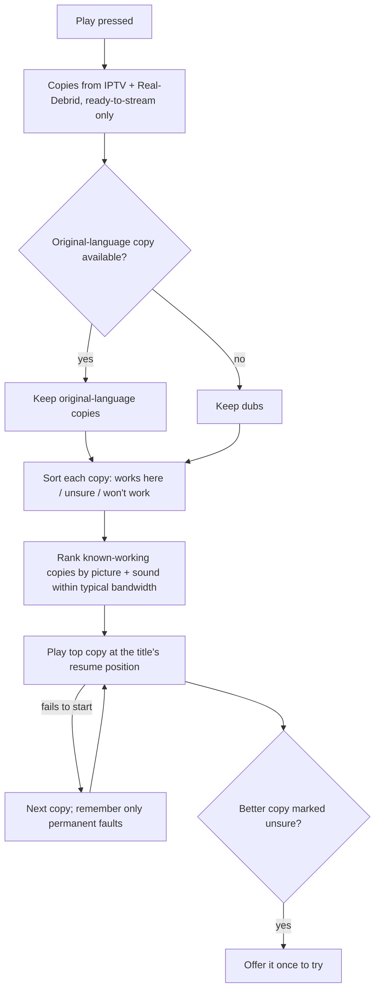
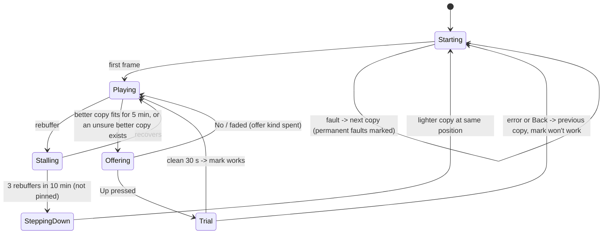
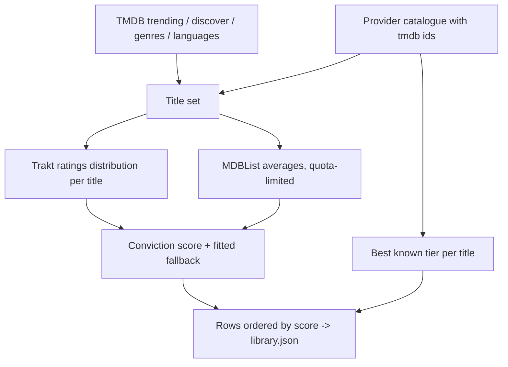

# Unified Movies & Shows - Plan

## Goal Capsule

- **Objective:** The Fire TV app is the one place to find and watch any film or show. It surfaces what is worth watching by scores the owner trusts, and it plays the best copy the current TV, stick and soundbar can handle, from IPTV or Real-Debrid. Every choice is automatic, visible, and reversible by hand.
- **Means:** The server discovers copies and builds a TMDB library with conviction scores. The stick ranks copies against its own setup and bandwidth, and makes every Real-Debrid account call itself (KTD1, KTD2).
- **Product authority:** The app's owner and sole user. The Product Contract wins on behaviour; KTDs win on mechanism. Live TV and live UFC are not active scope.
- **Execution profile:** Deep. Ships in three stages as commits pushed straight to `master`, per the project's always-deploy convention (no PRs). The server deploys through `deploy.yml`; the app reaches the stick through `firetv/dev.sh` and then the self-update.
- **Stop conditions:**
  - Stop and report if U1 shows that Real-Debrid cannot be checked and streamed from the stick's own IP.
  - Stop and report if the stick cannot play Real-Debrid links at all.
  - Stop U17 at its go/no-go if intro data covers too few of the owner's shows.
- **Who finishes:** `ce-work` (or the owner) per stage. Each stage is verified on the stick before the next starts.
- **Open blockers:** None. U1 is a spike that can still change KTD2 and KTD3.

---

## Product Contract

Product Contract preservation: R1–R5, R7, R8 and R11–R25 and R27 are unchanged in meaning. The 2026-11-05 review made these changes:
- R6 remembers only permanent failures.
- R9 does not step down a hand-picked copy (KTD12).
- R10's No ends only that kind of offer.
- R26 places the Watchlist and Recommended rows.
- R28 keeps language first when every original copy is untested.
- The Trakt Key Decision says watched marks combine every source.

The owner chose all of these during the review. R11 changed: the version list moves to the title page as well as Options (owner's choice during planning). R28–R33 were added at the owner's request during planning. AE7 was reworded because a soundbar behind the TV cannot be told apart from the TV itself.

### Summary

Movies & Shows becomes a title-first library built from TMDB. Rows are ordered by a conviction score and fed by the owner's Trakt and Letterboxd history. Pressing Play gathers copies from the IPTV provider and Real-Debrid and plays the best one for the current setup. Playback steps down when the connection fails, and offers better or untested copies once, never switching to them silently. The title page names the copy Play will use, and a Versions list lets the owner choose and correct any pick.

### Problem Frame

Films and shows live in two apps. The IPTV app has its own catalogue, but its copies are uneven: the "TOP MOVIES BLURAY" copy of Eternal Sunshine measured 1080p H.264 at 3.9 Mbps with stereo AAC. Its rows follow provider categories (4K groups, Blu-ray), not whether a film is any good. Nuvio and Stremio show a separate library backed by Real-Debrid, which often has far better copies (4K HDR or Dolby Vision, Atmos), but no live TV. Choosing what to watch means checking both apps and judging quality by hand.

The setup also changes: an LG OLED with Dolby Vision is planned, and the Sonos Beam Gen 2 sits behind the TV over eARC. A copy that is "best" on paper is wrong if this TV, stick or soundbar cannot show or play it, or if the Wi-Fi cannot carry it.

### Key Decisions

- **Real-Debrid adds titles as well as upgrading copies.** Any film or show can appear, whether or not the provider has it. Governs R15. (session-settled: user-directed — chosen over upgrade-only, which kept the IPTV catalogue and used Real-Debrid only to replace copies: one place to find anything.)
- **Title-first library.** Rows come from TMDB and the owner's history, and the source is resolved only at play. Governs R15, R17, R19. (session-settled: user-directed — chosen over keeping today's rows with any-title search, and over Real-Debrid-first with IPTV filling gaps: closest to an all-in-one app.)
- **Original language first, then quality.** Dubs are only a fallback. Governs R2. (session-settled: user-directed — chosen over English-first and pure-quality ranking.)
- **"Best" means best for the current setup.** The ranking uses what the TV, stick and soundbar report, plus measured bandwidth. Governs R3, R4, R5. (session-settled: user-directed — the owner asked that the pick adapt by itself when the TV, stick or soundbar change.)
- **Automatic by default, with manual control of everything.** Governs R11, R12, R13, R14. (session-settled: user-directed — chosen over a fully hidden source: the app can measure or choose wrong, so every choice must be visible and reversible.)
- **Transparent picks: the title page names the copy and offers Versions.** Governs R11, R29. (session-settled: user-directed — chosen over choosing only in Options and over choosing before every play: Play stays one press while the choice is always visible.)
- **Step down by itself, never step up by itself; offer the upgrade once.** Governs R9, R10. (session-settled: user-directed — chosen over never switching and over switching both ways automatically: a film that plays fine is never interrupted.)
- **Untested better copies are offered, never auto-played.** Governs R28. (session-settled: user-directed — the owner asked that a theoretically better copy whose support is uncertain be an option to try, not a gamble.)
- **Language rows are English, Arabic, Russian, then everything else; scores order the rows within them.** Governs R17, R18. (session-settled: user-directed — chosen over Arabic plus Spanish, German and Italian: the owner watches mostly English and cares about reviews more than language.)
- **Scores come from official APIs; scraping is a bonus.** Governs R22, R23, R24, R25. (session-settled: user-approved — proposed after the owner judged Letterboxd and IMDb scraping unlikely to work from the box: both APIs take free keys.)
- **Reviews show scores, rank rows, use the owner's history, and sync back.** Governs R18, R23, R26, R27. (session-settled: user-directed — the owner picked all four uses.)
- **Borrowed from Nuvio and Stremio: subtitles, new episodes in Up next, More like this and cast; skip intro only if worth it.** Governs R30, R31, R32, R33. (session-settled: user-directed — chosen from four offered features: More like this and cast only because they are cheap, skip intro only if worth it.)
- **Trakt receives what the app logs; watched marks combine every source.** Watched marks are the union of Trakt, the Letterboxd diary and the app's own marks. Letterboxd offers no write access, so only Trakt receives finished plays. Governs R8, R26, R27.
- **One plan, built in three stages.** Best copy first, because it is the largest quality win and it proves Real-Debrid works from this setup. Then the library and scores, then history. (session-settled: user-directed — chosen over planning only best-copy playback now, and over starting with the library.)

### Stages

| Stage | Delivers | Requirements |
|---|---|---|
| 1. Best copy | Sources, setup-aware picking, stall handling, offers, Versions, title-keyed resume | R1–R14, R28, R29 |
| 2. Library and scores | TMDB title-first rows, language rows, search, conviction scores, subtitles, More like this and cast | R15–R25, R30, R32 |
| 3. History | Trakt and Letterboxd history, Watchlist, recommendations, sync back, new episodes, skip intro | R26, R27, R31, R33 |

Stage 1 works on the current library: the copies for a provider title are gathered through its TMDB id. Stage 2 then builds the rows on the same title ids.

### Requirements

**Sources and picking (stage 1)**

- R1. Each play of a film or episode gathers that title's copies from the IPTV provider and from Real-Debrid. A Real-Debrid copy counts only if it is ready to stream immediately.
- R2. Copies in the title's original language are preferred. Dubbed copies are considered only when no original-language copy can play.
- R3. Eligible copies are ranked by picture and sound, counting only what the current TV, stick and soundbar report they support: resolution, HDR type, video codec, audio format and channel count.
- R4. The ranking uses the typical bandwidth from recent measurements, never a single reading. A copy heavier than that bandwidth ranks below one that fits.
- R5. Replacing the TV, stick or soundbar changes the next pick with no settings change.
- R6. When a copy fails to start, the next copy plays without asking. A permanent failure (KTD7) is remembered for this setup, and that copy is skipped on later plays. A temporary one, such as a busy provider or a timeout, is not.
- R7. Films and episodes play with a large buffer, so short bandwidth dips do not stall playback.
- R8. Resume position and watched marks belong to the title, not the copy or the source, so switching copy keeps the place. Marks saved today under provider ids carry over.

**Mid-film changes (stage 1)**

- R9. After repeated stalls mid-film, the app switches to the next lighter copy at the same position. It never switches to a better copy by itself. A copy the owner picked by hand is not stepped down; a notice offers the lighter copy instead (KTD12).
- R10. When the current copy was limited by bandwidth (picked that way or stepped down), and bandwidth then stays above a better copy's needs with margin for several minutes, a small notice offers that copy once. The notice does not pause or cover the film.
  - Yes switches to that copy at the same position.
  - No, or ignoring the notice until it fades, ends this kind of offer for the rest of that film. R28's offer is counted separately.
  - No offer appears in the last ~15 minutes or during the credits.
- R28. A copy that would rank higher but whose support on this setup is uncertain is never picked automatically while a known-working copy in the same language tier exists. It is offered once with the same kind of notice as R10, and listed as untested in Versions. Language still comes first (R2): when every original-language copy is untested, the best of them plays even if a dub works, and Back during its first 30 seconds returns to the dub.
  - Yes switches to it at the same position as a trial.
  - If the trial plays cleanly for about 30 seconds, the copy is marked as working on this setup.
  - If the trial errors, or the owner presses Back once within those 30 seconds, playback returns to the previous copy at the same position and the copy is marked as not working here.

**Manual control and transparency (stage 1)**

- R29. The title page names the copy Play will use (quality labels, source and size). The player's info line and Options name the copy that is playing.
- R11. A Versions list, opened from a button beside Resume on the title page and from Options while playing, shows every copy with its source, quality labels, picture tier and support state. Choosing one plays it, or switches to it at the same position.
- R12. The Versions list explains the pick: the capabilities the setup reported, the typical bandwidth used, and why each other copy ranked lower or was ruled out, including a source that is unavailable.
- R13. The owner can undo the app's judgements: clear a "failed on this setup" or "works here" mark, and reverse an automatic step-down.
- R14. The owner can correct a wrong reading, for example that audio does pass through as TrueHD, or that the bandwidth limit should be ignored. A correction applies to the setup it was made on and lasts until cleared; a setup that reports different capabilities starts without it.

**Library and search (stage 2)**

- R15. Movies & Shows is built title-first from TMDB. Any film or show can appear, whether or not the IPTV provider has it.
- R16. Up next (Continue watching) stays at the top of Movies & Shows.
- R17. Rows cover trending, new releases, genres, and original language in this order: English, Arabic, Russian, then everything else.
- R18. Within each row, titles are ordered by conviction score, so poorly reviewed titles sink.
- R19. The 4K and Blu-ray rows are removed. Each card shows the picture tier of the best copy known for that title.
- R20. Search matches titles and categories such as a genre or language ("Arabic", "comedy").
- R21. A title with no playable copy stays in its rows, and its page says it is unavailable.
- R30. When a playing copy has no subtitles in the wanted language (English first, then Arabic), subtitles are fetched from OpenSubtitles. Options offers a timing offset.
- R32. Title pages show a More like this row and the cast and director. Choosing a person lists their other titles.

**Scores (stage 2)**

- R22. Each film, show and episode gets a conviction score using TrueScore's net-conviction formula on Trakt's 1–10 rating distribution.
- R23. When a title's Trakt sample is too thin, its score falls back to MDBList's Letterboxd and IMDb averages.
- R24. Cards and title pages show the conviction score, plus the Letterboxd and IMDb averages, next to the quality chip.
- R25. Scraped IMDb and Letterboxd rating histograms are tried as a stronger input. When scraping is blocked, scores and rows still work from R22 and R23.

**History (stage 3)**

- R26. Watched marks, a Watchlist row and recommendations come from the owner's Trakt account and Letterboxd diary. Recommendations draw on what the owner rated highly.
  - Rows run Up next, Watchlist, Recommended, then R17's rows.
  - Watchlist and Recommended are hidden when empty.
  - Recommended leaves out watched titles.
- R27. Films and episodes the owner finishes in the app are logged to Trakt automatically.
- R31. Shows the owner follows put their next unwatched or newly aired episode in Up next.
- R33. A Skip intro prompt appears where intro timestamps exist. It ships only if timestamps cover enough of the owner's shows to be worth it.

### Key Flows

- F1. Press Play
  - **Trigger:** The owner presses Play or Resume on a film or episode.
  - **Steps:** Gather copies from both sources (R1) → keep original-language copies (R2) → drop copies the setup cannot show or play, or that failed here before (R3, R6) → rank the rest against typical bandwidth (R4), holding back untested ones (R28) → play the top copy at the title's resume position (R8) → if it fails to start, play the next (R6) → offer an untested better copy once (R28).
  - **Outcome:** The film plays on the best known-working copy, the title page and player name it (R29), and Versions explains why (R12).



- F2. Bandwidth drops and recovers mid-film
  - **Trigger:** Stalls repeat while a film plays.
  - **Steps:** Step down to the next lighter copy at the same position (R9) → bandwidth recovers and holds → one notice offers the better copy (R10) → Yes switches back; No or no answer ends offers for this film.
  - **Outcome:** The film keeps playing through the drop, and the owner decides whether to go back up.

- F3. The app chose wrong
  - **Trigger:** The owner thinks the pick is wrong (subtitles out of sync, wrong cut, a format the setup really does support).
  - **Steps:** Open Versions from the title page or Options → read why this copy was chosen (R12) → pick another copy (R11), undo a judgement (R13), or correct a reading (R14).
  - **Outcome:** The film plays on the owner's choice, and corrections shape later picks on this setup.

### Acceptance Examples

- AE1. **Covers R3.** **Given** the current TV reports HDR10 but not Dolby Vision, and the copies are a 4K Dolby Vision remux, a 4K HDR10 WEB-DL and a 1080p IPTV copy, **when** the owner presses Play, **then** the 4K HDR10 copy plays.
- AE2. **Covers R5.** **Given** the TV is replaced by an LG OLED that reports Dolby Vision, **when** the owner plays the same film, **then** the Dolby Vision copy plays, with no setting changed.
- AE3. **Covers R4.** **Given** recent sessions put typical bandwidth around 40 Mbps, and the copies are a 75 Mbps remux and a 25 Mbps WEB-DL, **when** the owner presses Play during a momentary dip to 10 Mbps, **then** the 25 Mbps copy plays.
- AE4. **Covers R2.** **Given** an Arabic-language film whose only copies are an Arabic 1080p IPTV copy and a 4K French dub, **when** the owner presses Play, **then** the Arabic 1080p copy plays.
- AE5. **Covers R9, R10.** **Given** a film stepped down after repeated stalls, and bandwidth back above the original copy's needs for several minutes, **when** the notice appears and the owner ignores it, **then** it fades, and no further offer appears for that film.
- AE6. **Covers R10.** **Given** the same recovery, but with 10 minutes of the film left, **then** no offer appears.
- AE7. **Covers R14.** **Given** the setup reports no TrueHD passthrough, **when** the owner corrects it to "passes TrueHD", **then** TrueHD-only copies become eligible on this setup. A setup reporting different capabilities starts without the correction.
- AE8. **Covers R8.** **Given** the owner stopped a film 40 minutes in on an IPTV copy, **when** they resume and the pick is now a Real-Debrid copy, **then** playback starts at 40 minutes.
- AE9. **Covers R28.** **Given** the best copy is a Dolby Vision file whose profile is unknown and a known-working HDR10 copy exists, **when** the owner presses Play, **then** the HDR10 copy plays and a notice offers the Dolby Vision copy once. If the owner accepts and presses Back within 30 seconds because the picture is blank, playback returns to the HDR10 copy at the same position and the Dolby Vision copy is marked as not working here.
- AE10. **Covers R29, R11.** **Given** a film whose pick is a Real-Debrid 4K HDR10 copy, **when** the owner opens its title page, **then** it shows that copy's labels and source beside Resume, and Versions lists every copy with the reason each ranks lower.

### Success Criteria

- For titles both sources carry, the copy that plays is never in a lower picture tier than the best IPTV copy the setup can handle.
- Films the owner would have opened Nuvio or Stremio for are found and played in this app instead.
- Playing a Real-Debrid copy leaves the IPTV account's one connection free for the nightly quality probe or for live TV.

### Scope Boundaries

- Live TV, live UFC and the TiviMate playlist do not change.
- Deferred: UFC replays sourced from Real-Debrid.
- Out: Real-Debrid copies that are not ready to stream immediately (anything that would need downloading first).
- Out: writing to Letterboxd. Its diary is read-only here.
- Out: switching to a better copy mid-film without the owner's yes.
- Retiring Nuvio and Stremio is the owner's choice, outside this plan.

#### Considered and not built

- A software decoder for TrueHD and DTS-HD (the FFmpeg extension). It is GPL and about 8 MB, and Dolby Digital Plus with Atmos tracks cover the common case. Revisit if the owner keeps seeing "unsure" lossless-only copies they want.
- The box proxying Real-Debrid bytes. It would double the box's bandwidth and still be one IP. The stick streams directly (KTD2).
- A second debrid service such as TorBox, which has no keyword filter. Revisit if Real-Debrid's filter keeps removing most 4K copies.
- A Letterboxd CSV import for history older than the RSS feed's 50 entries. Trakt history covers the gap.
- Live Trakt scrobbling (start, pause, stop). R27 only needs finished plays logged. Revisit if the owner wants "watching now" on Trakt.

#### Deferred to Follow-Up Work

- Gathering copies from the dormant backup provider (`XTREAM2_*`), once it is bought.
- ETags on `/api/app/library` if row payloads grow large.

### Dependencies / Assumptions

- The owner's existing Real-Debrid account, the one Nuvio and Stremio use.
- Free API keys for TMDB, Trakt, MDBList and OpenSubtitles, plus a free OpenSubtitles account and the owner's Letterboxd username. All of these go in the box's `.env`, never in chat or the repo.
- Assumption: MDBList's free tier (1,000 lookups a day) is enough once scores are cached.
- Assumption: Fire OS reports display, decoder and HDMI audio capabilities well enough to rank on. Where it reports them wrongly, R14 covers it.
- 173,128 of the 183,901 provider films (94%) carry a TMDB id. That is the join between the two sources for titles the provider has.

### Sources / Research

- `api/_lib.ts:793-803`: the VOD catalogue row carries the provider's TMDB id. `searchVod` (`api/_vod.ts:82-118`) and the Kotlin `Movie` drop it today.
- `api/_shows.ts:21,80`: shows carry a TMDB id, used for de-duplication only.
- `api/_quality-labels.ts:79-96`: `pictureTier`, the existing picture scale. It ignores HDR and audio.
- `firetv/app/src/main/java/com/mohamed3on/iptv/data/Movies.kt:150-217`: `ResumeStore` and `WatchedStore` are keyed by provider ids and embed the provider `Movie`.
- `../truescore/PRODUCT.md`, `../truescore/packages/extension/src/sites/imdb.ts`: the net-conviction formula `(top − bottom) × ((top − bottom) / total)`, which the IMDb site script applies to 9–10 against 1–2.
- Real-Debrid (official API docs; ElfHosted 2026-05-12; TorrentFreak 2026-05-14):
  - `instantAvailability` is gone.
  - Since about 2026-05-10, cached files can fail with `infringing_file`, 4K and WEB-DL worst.
  - One IP at a time: a warning, then a ban if it happens again within 7 days.
  - The API allows 250 requests a minute.
- Trakt API: per-title `/ratings` returns a `distribution`, with no batch. The limit is 1,000 GETs per 5 minutes. Sign-in uses the device-code flow, and refresh tokens rotate; access tokens last 24 h or 90 d, depending on the report.
- MDBList: 1,000 requests a day free, and returns Letterboxd and IMDb averages with vote counts. TMDB: discover by `with_original_language`, with `append_to_response=external_ids,credits,recommendations`.
- Fire TV Stick 4K Max (2nd gen):
  - Decodes Dolby Vision profiles 5 and 8. Profile 7 FEL shows a blank screen.
  - Community reports say it passes Dolby Digital Plus and Atmos through, but not TrueHD or DTS-HD.
  - Media3's `AudioCapabilities` reports these live.
- Research dossiers used for this plan are machine-local and not kept: repo patterns, Real-Debrid, APIs and device, and the flow analysis.

---

## Planning Contract

### Key Technical Decisions

- KTD1. **The stick ranks, the server describes.** The server returns every candidate copy with parsed attributes. A pure Kotlin ranker on the stick applies language, support, bandwidth, marks, corrections and pins, because only the stick knows its setup and bandwidth. One ranker, one language, unit-tested. Governs R2–R4, R28.
- KTD2. **Every Real-Debrid account call comes from the stick: cache check, link and stream.** The box never calls Real-Debrid. It keeps the token only in its `.env` and hands it to the stick in the app feed, as it does provider credentials, and it only discovers which torrents exist. The stick re-requests a link on every start, resume, or retry after an IP change, and never reuses a link across sessions. (session-settled: user-directed — the stick asks for links and streams, chosen over the box handing out links. Real-Debrid's rule is about two IPs streaming at once, and VPN changes between plays are fine.) Moving the cache check to the stick too follows from the same rule: the account then sees exactly one IP. U1 confirms this before anything builds on it. Governs R1.
- KTD3. **Discovery through Torrentio's Real-Debrid stream endpoint, from the box.** `GET torrentio.strem.fun/realdebrid=<key>/stream/{movie|series}/<id>.json` returns info hash, file index (from the `/resolve/…` URL), file name, release name and size per IMDb id (and per season and episode).
  - Torrentio builds it without calling Real-Debrid. It marks a copy `[RD+]` when one of its users resolved it in the last 14 days, and drops hashes that returned `infringing_file` (for 60 days). `[RD+]` copies reach the stick as `cached: true`.
  - The key is used only at `/resolve`, which we never call, so KTD2 holds.
  - Measured: the bare endpoint answers the box in ~0.1 s; the debrid one took 0.12–0.22 s. `[RD+]` was 36–95 % of copies across 6 titles. The bare list's order is a poor guide: 6 of Breaking Bad S01E01's top 10 are infringing.
  - TMDB ids map to IMDb ids through the TMDB client (KTD9). Results are cached per title for 6 h. Self-hosted Comet stays the fallback if Torrentio ever blocks the box; TorBox (a real batch cache check) is an optional second source if the `[RD+]` hit rate drops. Governs R1.
- KTD4. **Cache check on the stick: the account first, then only `[RD+]` copies, one at a time.** Real-Debrid has no cache check any more, so only an add tells. Measured: `infringing_file` comes back at `addMagnet` itself (HTTP 451, error 35, ~40 ms, no torrent made); `addMagnet` 429s (error 34) after ~5 quick adds, while list and info keep working; adds 4 s apart were clean. Order of checks:
  1. The account's own torrent list (~0.5 s), kept 15 min and added to after each successful add.
  2. Copies ranked above the best account copy and marked `cached`, in rank order, one at a time, at most 3 per Play: `addMagnet`, `info`, `selectFiles` (the file by Torrentio's file name, else index), `info`. Status `downloaded` means ready: 0.4 s for one file, ~2 s for a pack. `[RD download]` copies are never added automatically; both tested were 451.
  3. Adds at least 4 s apart, across the app. After a 429 or too-many-active-downloads, no adds for Retry-After or 60 s; the account copy or IPTV plays. Play never waits for an add's turn when an account copy exists.
  4. Keep a torrent only when it is `downloaded`, so the account list becomes the cache. Delete every torrent the check added that is not ready (`downloading`, `queued`, `magnet_conversion`). Otherwise uncached torrents would sit as active downloads until Real-Debrid refuses new magnets (its too-many-active-downloads error), which would also break Nuvio and Stremio on the same account.

  The prewarm (KTD13) runs the first add and keeps the ready torrent, so Play needs only a fresh unrestrict (~0.13 s). An `infringing_file` answer is a permanent fault for that copy (KTD7), and the stick posts the hash to the box (`POST /api/app/rd-infringing`) so no title offers it again. The filter changes over time (two hashes that were 451 in U1 played later the same day), so it is learned from 451s, not from release-name keywords. Torrentio's undocumented `selectFiles` `check_cache=1` is not used: what it does for an uncached hash is unknown. Governs R1.
- KTD5. **Copies carry parsed attributes.** Attributes are resolution, HDR type, Dolby Vision profile if named, codec, audio format and channels, Atmos, embedded-subtitle hints, language tags, size, and bitrate (size over TMDB runtime). Real-Debrid copies get them from the release name. IPTV copies keep today's sources: the measured reading, then the provider's probe, then the category claim (`api/_quality-labels.ts`). A measured reading always replaces parsed claims for that copy. Governs R3, R29.
- KTD6. **Each copy is sorted into works here, unsure, or won't work against a setup profile read live on the stick.**
  - The profile holds HDR types and modes (`Display.getHdrCapabilities`, API 30), decoders (`MediaCodecList`), and audio passthrough encodings and channels (Media3 `AudioCapabilities`), re-read on display and audio-device changes.
  - The setup fingerprint is the display name plus HDR types plus audio encodings. An empty or standby reading never changes the fingerprint or writes marks.
  - Fire TV rules: Dolby Vision profile 7 won't work. Dolby Vision with an unknown profile, and copies whose only audio is TrueHD or DTS-HD, are unsure. E-AC3-JOC counts as the best audio.

  Governs R3, R5, R14, R28.
- KTD7. **Only permanent faults write marks.**
  - Permanent: `infringing_file`, decoder or format unsupported, no playable audio track, a detected Dolby Vision profile 7, or a trial Back.
  - Transient: IPTV 458, 5xx, timeouts, an expired or 403 link, an IP change. These retry once, then move to the next copy with no mark.
  - Marks are keyed by setup fingerprint and copy. Real-Debrid marks expire after 30 days.

  Reuses `player/StreamErrors.kt` classification. Governs R6, R13.
- KTD8. **Bandwidth is measured on the stick, from loading bursts.** Each film session records bytes over time while the loader is actively filling the buffer. A file downloads as fast as the line allows, so this is capacity, unlike live TV.
  - Each film session contributes one sample per bucket: the median of its qualifying bursts. Buckets are source (IPTV or Real-Debrid) and hour-of-day band (night, day, evening peak).
  - Typical bandwidth is the 25th percentile of the last 20 session samples in the bucket, so one bad film tail cannot decide the next pick.
  - With no history, the pick is optimistic and step-down corrects it.
  - The same samples drive R10's recovery check, so no second connection is needed.

  Governs R4, R10.
- KTD9. **One server HTTP helper and a TMDB client.** The helper follows `askJev`'s timeout and retry shape (`api/_jev.ts`). The TMDB client fetches details with `external_ids` (IMDb id), `original_language`, runtime, credits and recommendations. Results are cached atomically in `.cache/tmdb-titles.json`, using the temp-file-and-rename pattern from `api/_quality.ts`. Stage 1 needs the TMDB key. Governs R1, R2, R32.
- KTD10. **Title ids.**
  - Films are `movie:<tmdb>` and shows are `tv:<tmdb>`. Episodes add `:s<season>e<episode>`.
  - Titles without a TMDB id use `iptv:<vodId>` and are never merged with others.
  - Resume entries store name, poster, year and runtime, so they render with no catalogue.
  - Stage 1 uses these final keys. A one-time migration maps existing provider-id marks through a server lookup.

  Governs R8.
- KTD11. **The film session is a new state machine shaped like `StreamSession`.** It has one work job, an injected clock and a fake player in tests, but is film-specific. It owns start, failover, step-down, both offers, trials, and link refresh. Thresholds:
  - Step down after 3 rebuffers within 10 minutes.
  - An offer becomes eligible when typical bandwidth in the current session is at least 1.3× the better copy's bitrate for 5 minutes, outside the last 15 minutes, and not while paused or with a panel open.
  - The notice shows for 12 s. Up (▲) accepts, because it is unused in the film player. While a notice is showing, Back dismisses it (spending that offer) without leaving the player. During a trial, Back undoes the trial (R28).
  - Each offer kind fires at most once per film session.
  - Each automatic step-down shows a short notice naming the new copy and that Versions can reverse it (R9, R13).

  Governs R6, R9, R10, R28.
- KTD12. **A version picked by hand is pinned for that title until cleared.** Stalls on a pinned copy show a "lighter version available" notice instead of stepping down. If the pinned copy hits a permanent fault, the pin clears and the notice says so. (session-settled: user-approved — proposed in the plan synthesis against letting step-down override a manual pick; the owner confirmed.) Governs R9, R11.
- KTD13. **Play waits at most 4 s for copies, with prewarming so it rarely needs to.**
  - Copies, ranking and the first Real-Debrid check batch are prewarmed when a title page opens, when an Up next card gets focus (Resume there skips the title page), and for the next episode once an episode starts.
  - If copies still aren't ready at 4 s, Play starts the IPTV copy of the title, if one exists, from the cached library. Copies arriving later appear in Versions, and in R28's offer when they are untested; there is no new offer kind.
  - A box outage never blocks a title the provider carries. Governs R1, F1.
- KTD14. **Film buffer by bytes.** Explicit 160 MB target, `prioritizeTimeOverSizeThresholds=false`, up to 120 s, 5 s after a rebuffer. This replaces the 20–50 s time-only buffer (`player/MoviePlayer.kt`). Media3 keeps buffered media on the Java heap, and the stick's default per-app heap (reported as 192 MB) cannot hold it beside the UI. So the manifest sets `android:largeHeap="true"` (reported as 384 MB on this stick). Governs R7.
- KTD15. **The ranking order is fixed and tested:**
  1. Language: original first.
  2. Support: works beats unsure.
  3. Fits typical bandwidth.
  4. Picture: resolution × supported HDR type, then bits per pixel.
  5. Audio: Atmos, then 5.1, then stereo.
  6. Ties: for a non-English original, a copy known to embed English subtitles (IPTV probe or an explicit release tag) wins. Missing subtitles are fetched for whichever copy plays (R30).
  7. Source: Real-Debrid wins remaining ties, because it leaves the IPTV connection free.

  A pin overrides all of it. Governs R2–R4.
- KTD16. **Conviction score.**
  - From Trakt's distribution: loved = votes of 9–10, hated = votes of 1–2, using the TrueScore formula.
  - Below 50 votes, the score is estimated so rows still sort on one scale. A linear fit, learned nightly from titles with at least 50 votes, maps MDBList's Letterboxd (else IMDb) average to Trakt's net share, (loved − hated) / total. The estimate is share × |share| × an effective vote count: the title's IMDb votes scaled by the library's median ratio of Trakt to IMDb votes. The volume term stays on Trakt's scale.
  - Titles with neither get their row's median.
  - Scraped histograms (R25), when the nightly job manages them, are pooled with Trakt's.

  Governs R18, R22, R23, R25.
- KTD17. **Library and scores are built by a nightly box job, not on request.**
  - Built by `deploy/iptv-library.timer` and written atomically to `.cache/library.json` and `.cache/scores.json`.
  - Trakt is paced at 3 requests a second. MDBList uses its daily quota, rows on screen first.
  - If TMDB is down or unset, `/api/app/library` serves the provider rows. Governs R15–R19.
- KTD18. **OpenSubtitles through the box, matched by file hash.**
  - The stick computes the OpenSubtitles hash from two 64 KB range reads plus the file size. The box searches by hash, then by TMDB id, downloads within the account's daily quota, and caches per hash.
  - The stick side-loads the subtitle at the current position.
  - The timing offset is applied by the box re-timing the cues. Governs R30.
- KTD19. **Trakt through the box.**
  - Sign-in uses Trakt's device-code flow, started from Options. The box polls and keeps tokens atomically in `.cache/trakt-token.json`, refreshing ahead of `expires_in` and saving the rotated refresh token.
  - When playback passes 90%, the stick sends one finished play through the box, which writes it to Trakt history (`/sync/history`). It is queued while offline with the `Telemetry` pattern, and a duplicate counts as success.
  - The Letterboxd RSS feed is read by the box; when it is blocked, it is skipped and reported as a source status. Governs R26, R27, R31.
- KTD20. **Live TV still stops for any film,** because a hidden live stream would compete for bandwidth. A 458 only affects IPTV copies, so a busy provider connection never blocks a Real-Debrid film. Governs Success Criteria.

### High-Level Technical Design

Who does what at Play (stage 1):

```mermaid
sequenceDiagram
  participant App as Stick (app)
  participant Box as Box (/api/app)
  participant TIO as Torrentio
  participant TMDB
  participant RD as Real-Debrid API
  participant CDN as RD download / IPTV provider
  App->>Box: GET copies(title id) [on title page open]
  Box->>TMDB: details (imdb id, language, runtime) [cached]
  Box->>TIO: stream list by imdb id [cached 6 h]
  Box-->>App: IPTV copies + RD candidates with attributes
  App->>App: setup profile + typical bandwidth + marks -> rank
  App->>RD: torrent list, then addMagnet/selectFiles/info for top 3
  App->>RD: unrestrict link (stick's own IP)
  App->>CDN: stream best copy (range requests)
```

Film session (stage 1), covering step-down, offers and trials:



Nightly library and scores (stage 2):



### Assumptions

- Public Torrentio answers from the box. U1 checks this, and KTD3 names the fallback.
- The 4K Max stick runs Fire OS 8 (API 30), so `Display.getHdrCapabilities` (deprecated in API 34) is the right call.
- 160 MB of buffer fits alongside the app on the stick. U7 checks this on the device.

### Sequencing

Stages run in order. Within stage 1, U1 gates everything that touches Real-Debrid. U2 and U3 (server) can be built alongside U4–U7 (app), and U9–U10 join them. Stage 2 needs U2's TMDB client. Stage 3 needs stage 2's title pages and Up next.

---

## Implementation Units

| U-ID | Title | Main files | Depends on |
|---|---|---|---|
| U1 | Real-Debrid and Torrentio spike | `scripts/rd-spike.ts` (temporary) | none |
| U2 | Title ids and TMDB client on the server | `api/_http.ts`, `api/_tmdb.ts`, `api/_vod.ts`, `api/_shows.ts`, `api/app.ts` | U1 |
| U3 | Copies endpoint and release-name parsing | `api/_copies.ts`, `api/_release-name.ts`, `server.ts` | U2 |
| U4 | Title-keyed resume and watched, with migration | `data/Titles.kt`, `data/Movies.kt`, `App.kt` | U2 |
| U5 | Setup profile reader | `player/Setup.kt` | none |
| U6 | Copy ranker | `player/CopyRanker.kt` | U5 |
| U7 | Bandwidth samples and film buffer | `player/Capacity.kt`, `player/MoviePlayer.kt` | none |
| U8 | Real-Debrid client on the stick | `data/RealDebrid.kt`, `data/FeedSync.kt` | U1 |
| U9 | Film session state machine | `player/FilmSession.kt` | U6, U7, U8 |
| U10 | Playback wiring, Versions, title page and notices | `ui/MoviePlayback.kt`, `ui/Movies.kt`, `ui/Versions.kt` | U3, U4, U9 |
| U11 | TMDB library builder and nightly job | `api/_library.ts`, `scripts/build-library.ts`, `deploy/iptv-library.*` | U2 |
| U12 | Conviction scores | `api/_scores.ts` | U11 |
| U13 | Library UI, scores, search, More like this and cast | `ui/Movies.kt`, `data/Movies.kt`, `api/app.ts` | U11, U12, U10 |
| U14 | OpenSubtitles | `api/_subtitles.ts`, `player/SubtitleFetch.kt` | U10 |
| U15 | Trakt connect and finished-play logging | `api/_trakt.ts`, `data/TraktSync.kt` | U13 |
| U16 | History rows, Letterboxd, new episodes in Up next | `api/_history.ts`, `ui/Movies.kt` | U15 |
| U17 | Skip intro go/no-go | `api/_intros.ts` (only on go) | U16 |

App paths are under `firetv/app/src/main/java/com/mohamed3on/iptv/`, and app tests under `firetv/app/src/test/java/com/mohamed3on/iptv/`.

### Stage 1: Best copy

### U1. Real-Debrid and Torrentio spike

- **Goal:** Prove KTD2–KTD4 on the owner's real account and setup before anything builds on them.
- **Requirements:** R1; KTD2, KTD3, KTD4.
- **Dependencies:** None.
- **Files:** `scripts/rd-spike.ts` (bun + TS, run from the box for Torrentio only) and a throwaway debug path in the app for the Real-Debrid calls. Both are deleted after the findings land in this plan.
- **Approach:**
  1. From the box, fetch Torrentio's stream list for three known IMDb ids (a 4K film, a 1080p film, a show episode). Record reachability and response shape.
  2. From the stick itself (a debug build), for those candidates: list the account's torrents, then `addMagnet`, `selectFiles` and `info`. Record status, latency and any `infringing_file`, and delete the torrents that are not ready.
  3. `unrestrict` and stream on the stick, so the link is always made and played on the same IP. Run once with the stick's VPN on and once with it off. Note how long the link stays valid.
  4. Update KTD2–KTD4 in place if anything differs. If Real-Debrid refuses the VPN exit, record that the app's Real-Debrid calls and streams must bypass the VPN. If Torrentio is blocked, U3 switches to self-hosted Comet.
- **Execution note:** This is a spike with no production code. Its output is the updated KTDs.
- **Test expectation:** none -- spike; findings land in this plan.
- **Verification:** KTD2–KTD4 reflect measured behaviour. From the stick's IP (VPN off): account list ~0.5 s, a ready check 0.4–2 s, unrestrict 0.13 s, first byte 0.32 s, 169 Mbps. KTD13's 4 s budget holds for an account or prewarmed copy; a cold check that needs spaced adds can miss it, and IPTV starts.
- **Status:** Done 2026-11-05, except the VPN-on run (step 3). Torrentio answers the box, so no Comet. Blind adds down the bare list were mostly 451, which led to KTD3's debrid endpoint and KTD4's `[RD+]`-only adds.

### U2. Title ids and TMDB client on the server

- **Goal:** Every film, show and episode the app sees carries its title id, IMDb id and original language.
- **Requirements:** R1, R2, R8; KTD9, KTD10.
- **Dependencies:** U1.
- **Files:** `api/_http.ts` (new), `api/_tmdb.ts` (new), `api/_tmdb.test.ts` (new), `api/_vod.ts`, `api/_shows.ts`, `api/_lib.ts` (the 4K rows join to the catalogue by provider id), `api/app.ts`, `server.ts` (`POST /api/app/title-ids` for U4's migration).
- **Approach:**
  1. `_http.ts`: a fetch helper with timeout, retries and a User-Agent, following `askJev`.
  2. `_tmdb.ts`: a details lookup (with `external_ids`, credits and recommendations), cached atomically, enabled only when `TMDB_TOKEN` is set.
  3. Add `title` (the KTD10 key) to the outputs of `/api/app/movies`, `shows`, `episodes` and `vod-search`. The 4K `Channel` rows get theirs through the catalogue's tmdb column.
  4. `POST /api/app/title-ids` maps lists of provider film, series and episode ids to title ids.
- **Patterns to follow:** `api/_jev.ts` (retry), `api/_quality.ts` `saveQuality` (atomic write), `backupConfigFromEnv` (optional key), the handler conventions in `api/app.ts`.
- **Test scenarios:**
  - A catalogue row with tmdb `"1378537"` produces title `movie:1378537` in vod-search output.
  - A row with an empty tmdb produces `iptv:<id>`, and two such rows never share a title.
  - A 4K `Channel` row with no tmdb field gets its title from the catalogue by provider id.
  - The title-ids endpoint maps an episode id to `tv:<tmdb>:s1e3` using the show's tmdb plus season and episode.
  - With `TMDB_TOKEN` unset, endpoints still answer, with titles but no IMDb or language data.
- **Verification:** The app feed snapshot (`api/__snapshots__`) shows `title` on every item. `bun test` passes.

### U3. Copies endpoint and release-name parsing

- **Goal:** `GET /api/app/copies?title=…` returns every IPTV and Real-Debrid candidate copy of a title with attributes.
- **Requirements:** R1, R2, R3, R29; KTD3, KTD5.
- **Dependencies:** U2.
- **Files:** `api/_copies.ts` (new), `api/_release-name.ts` (new), `api/_copies.test.ts` (new), `api/_vod.ts` (every copy of a title, not only the best), `api/app.ts`, `server.ts`.
- **Approach:**
  1. IPTV copies: every catalogue entry with the title's tmdb (films), or the show's episode entries per language (episodes). Attributes come from the measured, probed or claimed sources (`api/_shows.ts` `movieInfo`), and language from the name prefix or category.
  2. Real-Debrid candidates: Torrentio by IMDb id (with `:s:e` for episodes). Parse each release name into the KTD5 attributes; bitrate is size over runtime.
  3. Return `{ title, originalLanguage, runtime, copies: [...] }`, cached 6 h (`s-maxage`) in the server cache.
- **Patterns to follow:** `searchVod` grouping, `streamLabels`, `categoryLabels`.
- **Test scenarios:**
  - `Movie.2019.2160p.UHD.BluRay.REMUX.DV.HDR.HEVC.TrueHD.7.1.Atmos-GRP` parses to 2160p, Dolby Vision (profile unknown), HDR10, HEVC, TrueHD Atmos 7.1, remux.
  - `Movie.2019.1080p.WEB-DL.DDP5.1.Atmos.H.264` parses to 1080p, H.264, E-AC3 Atmos 5.1, SDR.
  - A name with `MULTi` or `iTALiAN` gets those language tags. A plain English release gets no dub tag.
  - `DV.P7` or `FEL` in a name sets profile 7.
  - A film with three catalogue entries (EN 4K, EN Blu-ray, DE 4K) returns all three IPTV copies, with languages.
  - A Torrentio failure returns IPTV copies alone, with a `sources.rd = "unavailable"` status.
- **Verification:** For a known film, the endpoint lists IPTV and Real-Debrid copies with sensible labels.

### U4. Title-keyed resume and watched, with migration

- **Goal:** Resume and watched marks follow the title, survive copy changes, and carry over existing marks.
- **Requirements:** R8, R21; KTD10.
- **Dependencies:** U2.
- **Files:** `data/Titles.kt` (new: title id and resume entry with name, poster, year and runtime), `data/Movies.kt` (`ResumeStore` and `WatchedStore` re-keyed), `App.kt`, `data/FeedSync.kt` (migration call), test `TitleMigrationTest.kt` (new).
- **Approach:**
  1. New stores under new prefs keys. The old keys stay readable until migration succeeds, so an older APK keeps working.
  2. On first launch, send the old provider ids to `POST /api/app/title-ids`, write the new entries, and mark the migration done. Failure retries next launch.
  3. Resume entries for titles with no copy left still render in Up next (R21).
- **Patterns to follow:** `ResumeStore`'s CAP and newest-first ordering, `MapStore` in tests.
- **Test scenarios:**
  - Covers AE8. Resume saved under `movie:603` at 40 min starts at 40 min whichever copy is picked.
  - Migration maps provider film 2219248 to `movie:1378537` and keeps its position and timestamp.
  - An episode resume `(show 77, episode 9001)` migrates to `tv:95396:s2e4`.
  - A failed migration call leaves the old marks intact and retries.
  - The watched sets of two language variants of one show merge into one title.
- **Verification:** After installing the new build, Up next and watched marks match what the stick showed before.

### U5. Setup profile reader

- **Goal:** The stick knows, at every Play, what the current TV, stick and soundbar can show and play.
- **Requirements:** R3, R5, R14; KTD6.
- **Dependencies:** None.
- **Files:** `player/Setup.kt` (new), `player/FrameRate.kt` (shares the display read), test `SetupTest.kt` (new, Robolectric, pure mapping only).
- **Approach:**
  1. The profile holds HDR types and modes, decoders (Dolby Vision profiles from `MediaCodecList`), and passthrough encodings and maximum channels from Media3 `AudioCapabilities`.
  2. Listen for display changes and Media3's audio-capabilities receiver, and expose the current profile and fingerprint.
  3. Ignore empty readings (TV off or other input): keep the last stable profile.
  4. Log the profile once per change under the `IptvSetup` tag, for on-device checks.
- **Test scenarios:**
  - HDR types {HDR10, HLG} plus encodings {AC3, E-AC3, E-AC3-JOC} give a profile with no Dolby Vision, Atmos over Dolby Digital Plus, and no TrueHD.
  - An empty encodings list does not replace the last stable profile or change the fingerprint.
  - Adding Dolby Vision to the HDR types changes the fingerprint.
- **Verification:** On the stick, logcat shows the profile. Switching Fire OS audio from "Best available" to PCM changes the encodings live.

### U6. Copy ranker

- **Goal:** A pure, tested function turns copies plus setup, bandwidth, marks, corrections and pins into a ranked list, with a support state and a reason per copy.
- **Requirements:** R2, R3, R4, R12, R13, R14, R28; KTD6, KTD15.
- **Dependencies:** U5.
- **Files:** `player/CopyRanker.kt` (new), test `CopyRankerTest.kt` (new).
- **Approach:**
  1. Classify support (KTD6), apply marks and corrections, keep original-language copies first (R2), then order per KTD15.
  2. Return each copy's state (works, unsure, won't) and a short reason for Versions (R12): "Dolby Vision not supported", "needs ~70 Mbps, typical 40", "failed here on 3 Nov", "dub".
  3. Output the pick, the best unsure copy above it (for R28's offer), and the next lighter working copy (for R9).
- **Execution note:** Implement test-first; the acceptance examples are the tests.
- **Test scenarios:**
  - Covers AE1. A TV without Dolby Vision, with a DV remux, an HDR10 WEB-DL and a 1080p IPTV copy, picks the HDR10 WEB-DL.
  - Covers AE2. The same copies with a Dolby Vision profile 8 setup pick the DV copy.
  - Covers AE3. Typical 40 Mbps with a 75 Mbps remux and a 25 Mbps WEB-DL picks the WEB-DL, and the remux's reason names bandwidth.
  - Covers AE4. An Arabic original whose copies are an Arabic 1080p and a French 4K dub picks the Arabic copy.
  - Covers AE7. A TrueHD-only copy is unsure, becomes "works" after a "passes TrueHD" correction, and is unsure again under another fingerprint.
  - Covers AE9. An unknown-profile DV copy above a working HDR10 copy: the pick is HDR10, and the DV copy is returned as the offer.
  - A copy marked failed on this fingerprint is "won't" with its date. The same mark under another fingerprint has no effect.
  - A pinned copy is picked even when another ranks higher.
  - Only unsure copies exist: the best unsure copy is picked (R28 applies only when a working copy exists).
  - Every original-language copy is unsure and a French dub works: the best unsure original is picked, with the dub as the trial's way back (R2, R28).
  - A tie between an IPTV and a Real-Debrid copy picks Real-Debrid.
  - A non-English original with two otherwise equal copies: the one known to embed English subtitles wins. A 720p copy with subtitles never beats a 4K copy without.
- **Verification:** All scenarios pass in `testReleaseUnitTest`.

### U7. Bandwidth samples and film buffer

- **Goal:** The stick learns typical bandwidth per source and time of day, and films buffer by bytes.
- **Requirements:** R4, R7, R10; KTD8, KTD14.
- **Dependencies:** None.
- **Files:** `player/Capacity.kt` (new: sampler and store), `player/MoviePlayer.kt` (load control, transfer listener), `firetv/app/src/main/AndroidManifest.xml` (`largeHeap`), test `CapacityTest.kt` (new).
- **Approach:**
  1. A transfer listener measures bytes per second during loading bursts of at least 2 s, and ignores idle gaps.
  2. At session end, store one sample per bucket (the median of the session's bursts). Keep the last 20 per source and hour band in `KeyValueStore`, and expose the 25th percentile.
  3. A live session estimate from the bursts themselves, for R10's offer check.
  4. Load control and `largeHeap` per KTD14. During a 4K remux, check the Java Heap line of `dumpsys meminfo com.mohamed3on.iptv` against the heap limit.
- **Patterns to follow:** `HealthModel` windowing, `api/_quality.ts` `medianMbps`, `PlayerPool.ByteCounter`.
- **Test scenarios:**
  - Session samples of 30, 35, 40, 80 and 90 Mbps in the evening band give a typical bandwidth of 35 Mbps.
  - A 1 s burst is ignored.
  - A session with 40 bursts adds one sample, its median burst.
  - Evening samples do not affect the day band's estimate.
  - No samples: the estimate is "unknown", and the ranker treats it as optimistic.
- **Verification:** On the stick, logcat shows samples after a film, and a 4K remux plays without out-of-memory errors.

### U8. Real-Debrid client on the stick

- **Goal:** The stick can check, prepare and get links for Real-Debrid copies from its own IP.
- **Requirements:** R1, R6; KTD2, KTD4, KTD7.
- **Dependencies:** U1.
- **Files:** `data/RealDebrid.kt` (new), `data/FeedSync.kt` (token delivery), `api/app.ts` (token in the app feed, like provider credentials), test `RealDebridTest.kt` (new, mockwebserver).
- **Approach:**
  1. Calls: torrent list (cached for the session), `addMagnet`, `selectFiles`, `info`, `unrestrict`. Respect 429 `Retry-After`.
  2. Map errors to KTD7 classes: `infringing_file` is permanent, 503 and timeouts are transient, 401 means the token is invalid (source status), 429 and too-many-active-downloads are transient (source status).
  3. Delete every torrent a check added that is not `downloaded` (KTD4).
  4. The token reaches the stick in the feed (`REAL_DEBRID_TOKEN` in the box `.env`); the box never calls Real-Debrid.
- **Test scenarios:**
  - A torrent already in the account list skips `addMagnet`.
  - `info` with status `downloaded` makes the copy ready and keeps the torrent. `downloading` makes it not ready, and the torrent is deleted.
  - A too-many-active-downloads error is classified as transient and sets the Real-Debrid source status.
  - An `infringing_file` error is classified as permanent.
  - A 503 on `unrestrict` is classified as transient.
  - A 401 sets the Real-Debrid source status to "token invalid".
- **Verification:** On the stick, a known cached film resolves to a link and plays.

### U9. Film session state machine

- **Goal:** One tested state machine runs a film from first copy to end: failover, step-down, offers, trials, and link refresh.
- **Requirements:** R6, R9, R10, R13, R28; KTD7, KTD11, KTD12.
- **Dependencies:** U6, U7, U8.
- **Files:** `player/FilmSession.kt` (new), test `FilmSessionTest.kt` (new).
- **Approach:**
  1. Inputs are the ranker output, a player interface (`StreamPlayer`-like), the capacity estimate, a clock, and resolvers for Real-Debrid links and IPTV URLs.
  2. States as in the film-session state diagram under High-Level Technical Design. Every copy switch carries the position and the chosen audio and subtitle language.
  3. A Real-Debrid link is requested fresh on every start and title resume (KTD2). Within a session it is re-requested after a pause longer than 10 minutes, any IP change, or any 403.
  4. Emit events for the notice UI and for telemetry (extend the `/api/app/events` types with `failover`, `stepdown`, `offer`, `trial`).
- **Patterns to follow:** `StreamSession` (single work job, injected `now`, fake player), `Cushion` stall counting, the `StreamErrors` split.
- **Test scenarios:**
  - First copy throws a permanent error: the next copy starts, and a mark is written for the first.
  - First copy returns IPTV 458: the next copy starts with no mark.
  - Covers AE5. Three rebuffers within 10 min step down. Recovery for 5 min raises one offer. Expiring it raises no more offers this session.
  - Covers AE6. Recovery with 10 min left raises no offer.
  - Covers AE9. Accepting a trial, then Back within 30 s, returns to the previous copy at the same position and marks the trial copy "won't" for this fingerprint.
  - A trial with 30 clean seconds marks the copy "works".
  - Stalls on a pinned copy raise a "lighter version" notice and do not step down.
  - A failed switch during an offer returns to the current copy, and the offer stays spent.
  - A Real-Debrid copy resumed after a 15 min pause requests a fresh link before playing.
  - Every copy failing ends in the Unavailable state.
  - Copies not returned within 4 s: the title's IPTV copy from the cached library starts. Copies arriving later feed Versions and the offers, not a switch.
- **Verification:** All scenarios pass in `testReleaseUnitTest`.

### U10. Playback wiring, Versions, title page and notices

- **Goal:** The owner sees and controls everything stage 1 decides.
- **Requirements:** R1, R11, R12, R13, R14, R29, F1, F3, AE10; KTD13, KTD20.
- **Dependencies:** U3, U4, U9.
- **Files:**
  - `ui/MoviePlayback.kt`: drives `FilmSession`, adds the corner notice, maps Up to accept and Back to trial undo, adds a Versions page to the Options panel.
  - `ui/Versions.kt` (new): the list with a reason per copy, undo marks, corrections, source statuses.
  - `ui/Movies.kt`: title page "Plays:" line and a Versions button beside Resume, prewarm on page open, Real-Debrid-aware `play()`.
  - `data/FeedSync.kt`: the copies call.
  - `player/Setup.kt`: corrections store.
- **Approach:**
  1. Prewarm per KTD13 (title page, Up next focus, next episode).
  2. Title page: a fixed one-line "Plays:" slot that stays empty until the ranking is ready. It shows the IPTV copy if copies fail or time out, and updates in place without moving any button. The Versions button is there from the start and shows a loading row if the list isn't ready. On a show page, the focused episode row carries its own "Plays:" caption, and Versions for that episode opens from the row with Menu (☰).
  3. Play: KTD13 budget, then `FilmSession`. Live stops as today (KTD20).
  4. Notices: reuse the `HealthCorner` placement and Night Glass material (`DESIGN.md`), with a key cap for ▲ from `MainActivity` `KeyCap`. They never pause or cover the picture. One notice at a time, by priority: Skip intro, trial result, offers, then information (step-down, pin cleared, subtitles). A lower one waits, and a waiting offer whose window passes is dropped without spending it. Back behaviour per KTD11.
  5. Versions: at most 8 rows plus "Show all", grouped as working, untested and not working, with a reason line each.
     - OK on a row plays that copy and pins it (KTD12). A pinned row carries "Pinned".
     - On a row with a pin or a mark, Menu (☰) offers Clear.
     - Corrections are a short list of toggles at the foot of the page, each showing its current state.
     - Source statuses (Real-Debrid, TMDB, OpenSubtitles) sit under the corrections.
     - Pins, marks and corrections write to the stores from U6.
- **Patterns to follow:** `MoviePanel` / `PanelRow` (`ui/QuickPanel.kt`), `FilmPage` buttons, `DESIGN.md` panel rules.
- **Test expectation:** none for UI (project policy). Behaviour is covered by U6 and U9.
- **Verification:** On the stick:
  - A known film shows its pick on the title page and the same copy plays.
  - Versions lists both sources with reasons.
  - A forced bad copy (a mark set by hand) is skipped.
  - The offer notice shows with ▲ and fades.
  - With the box stopped, the IPTV copy still plays within about 4 s.

### Stage 2: Library and scores

### U11. TMDB library builder and nightly job

- **Goal:** A nightly box job builds the title-first rows.
- **Requirements:** R15, R16, R17, R19, R21; KTD17.
- **Dependencies:** U2.
- **Files:** `api/_library.ts` (new), `scripts/build-library.ts` (new), `deploy/iptv-library.service` and `deploy/iptv-library.timer` (new), `deploy/sync.sh` (enable the timer), `api/app.ts` (`/api/app/library`), `api/_library.test.ts` (new).
- **Approach:**
  1. Rows: trending films and shows (week), new releases, a set of genres, and language rows: English, Arabic, Russian, then the rest (`with_original_language`, `vote_count.gte` for films).
  2. Merge in provider titles so the provider's catalogue stays findable. Each title gets its best known tier from IPTV copies plus copies seen earlier.
  3. Write atomically. The endpoint serves `library.json`, or the provider rows when it is missing or stale beyond 3 days.
- **Test scenarios:**
  - A TMDB fixture with films in `en`, `ar`, `ru` and `ko` puts them in the matching language rows, with `ko` under "Other".
  - A missing `library.json` makes the endpoint return provider rows.
  - A title with no known copy still appears, with no tier.
- **Verification:** On the box, the timer runs, `library.json` is written, and the endpoint returns rows.

### U12. Conviction scores

- **Goal:** Every library title has a conviction score on one scale.
- **Requirements:** R18, R22, R23, R25; KTD16, KTD17.
- **Dependencies:** U11.
- **Files:** `api/_scores.ts` (new), `api/_scores.test.ts` (new), `scripts/build-library.ts`.
- **Approach:**
  1. Trakt `/ratings` per title at 3 requests a second, with a weekly TTL (daily for releases under 60 days old).
  2. MDBList for titles under 50 Trakt votes, rows on screen first, within the daily quota.
  3. Fit Letterboxd and IMDb averages to Trakt's net share and estimate thin titles per KTD16. Titles with neither get the row median.
  4. Scraped histograms behind a flag. They are tried nightly, and a failure is logged once and skipped (R25).
- **Test scenarios:**
  - Distribution {10: 500, 9: 300, 1: 50, 2: 50, others: 100}, total 1000: loved 800, hated 100, score 700 × 0.7 = 490.
  - 30 Trakt votes with a Letterboxd 4.1 average use the fitted estimate: the fitted share squared (sign kept) times the effective vote count from IMDb votes.
  - Two thin titles with the same fitted share: the one with more IMDb votes scores higher.
  - A title with no data gets its row's median.
  - A run with the MDBList quota exhausted keeps earlier scores and fills the rest the next night.
- **Verification:** `scores.json` covers the library's titles after a few nights, and rows are sorted by score.

### U13. Library UI, scores, search, More like this and cast

- **Goal:** The app shows the new library.
- **Requirements:** R15–R21, R24, R32; KTD17.
- **Dependencies:** U10, U11, U12.
- **Files:** `ui/Movies.kt` (rows from `/api/app/library`, score chips in `MetaLine`, unavailable state, 4K and Blu-ray rows removed, More like this row, cast and person pages), `data/Movies.kt` (library model, which now holds films and shows), `api/app.ts` (`/api/app/search` with TMDB search plus genre and language words, `/api/app/person`).
- **Approach:**
  1. Films and shows share one library. Up next stays first.
  2. Scores use TrueScore's own display: the conviction score with its net share in brackets, for example "490 (70%)", and a leading "~" when estimated. Cards show only the conviction score beside the tier chip, within the 13 sp floor. Title pages add Letterboxd ★ and IMDb in the meta line.
  3. Unavailable page (R21): no Play or Versions. "No copy available" sits in the plot column, and focus lands on the first More like this card.
  4. Cast and director form a focusable row on the title page. OK opens a person page: a poster grid titled with their name, ordered by score. Back returns to the title.
  5. Search maps category words ("arabic", "comedy") to rows or a discover query. Other words go to TMDB search plus the provider catalogue.
  6. More like this and cast come from TMDB `append_to_response` (U2's client).
- **Patterns to follow:** `Rows`, `PosterRow`, `MetaLine`, `TierChip`, `SearchGrid`.
- **Test scenarios:**
  - `api/app.ts` search: "arabic" returns the Arabic row's titles.
  - Search: "inception" returns `movie:27205` first.
  - A person query returns their credits ordered by score.
- **Verification:** On the stick, rows load within the frame budget (`dumpsys gfxinfo`), cards show scores, and the "unavailable" page renders.

### U14. OpenSubtitles

- **Goal:** Copies without wanted subtitles get them, with a timing offset.
- **Requirements:** R30; KTD18.
- **Dependencies:** U10.
- **Files:** `api/_subtitles.ts` (new), `api/_subtitles.test.ts` (new), `api/app.ts`, `player/SubtitleFetch.kt` (new: hash and side-load), `ui/MoviePlayback.kt` (Subtitles page: fetched tracks plus an offset in ±0.5 s steps).
- **Approach:**
  1. After start, if no text track exists in English (or Arabic), compute the hash and request subtitles from the box.
  2. The box searches by hash, then by title id. It downloads within the quota and caches per hash and language.
  3. Side-load at the current position and select the fetched track automatically, with a brief corner notice. The Subtitles page shows the search state ("Searching", "None found", "No subtitles today").
  4. The offset makes the box re-time the cues. The current subtitle stays on screen until the re-timed one is loaded.
- **Test scenarios:**
  - Re-timing an SRT by +1.5 s shifts every cue and keeps them in order.
  - A cached hash is served without calling OpenSubtitles.
  - An exhausted quota returns a "no subtitles today" status.
- **Verification:** On the stick, a foreign film lacking English subtitles gets them, and the offset moves them.

### Stage 3: History

### U15. Trakt connect and finished-play logging

- **Goal:** The owner connects Trakt once, and finished plays are logged there.
- **Requirements:** R27; KTD19.
- **Dependencies:** U13.
- **Files:** `api/_trakt.ts` (new: device flow, tokens, history write), `api/_trakt.test.ts` (new), `api/app.ts`, `server.ts`, `data/TraktSync.kt` (new: queued finished plays), `ui/MoviePlayback.kt` (a 90% hook), `ui/QuickPanel.kt` (Options: Trakt row).
- **Approach:** The Options Trakt row has five states, and focus lands on each state's main action:
  - Not connected: Connect.
  - Waiting: a large code, `trakt.tv/activate`, and Cancel.
  - Expired or denied: a message and Try again.
  - Connected: the account name and Disconnect.
  - Needs reconnect: Reconnect, shown when a refresh fails.
- **Test scenarios:**
  - A token response with `expires_in` 86400 schedules a refresh before expiry, and the rotated refresh token is saved.
  - Passing 90% sends one finished play. Seeking back and passing 90% again in the same session sends nothing more.
  - A duplicate answer counts as success.
  - Finished plays recorded offline are queued and sent later.
- **Verification:** Finishing a film on the stick shows it in the owner's Trakt history.

### U16. History rows, Letterboxd, new episodes in Up next

- **Goal:** The library reflects the owner's history.
- **Requirements:** R26, R31; KTD19.
- **Dependencies:** U15.
- **Files:** `api/_history.ts` (new), `api/_history.test.ts` (new), `scripts/build-library.ts` (Watchlist and Recommended rows), `api/app.ts`, `ui/Movies.kt` (Up next merges new episodes).
- **Approach:**
  1. Watched marks are the union of Trakt history, the Letterboxd RSS feed and local marks. Local marks are not back-filled to Trakt.
  2. The Watchlist row comes from Trakt. Recommendations come from Trakt, rank by score and leave out watched titles. Both rows sit after Up next and are hidden when empty (R26).
  3. Followed shows are shows with Trakt or local history in the last 6 months. Their next episode comes from Trakt's progress, or else from TMDB plus local marks, and goes into Up next labelled "New episode" when it is newly aired.
  4. Up next order: in-progress items first, then new episodes by air date. A show with an episode in progress shows only that episode. A new episode takes the hero slot only when nothing is in progress. "New episode" is an accent caption on the wide card.
- **Test scenarios:**
  - A Letterboxd RSS item with `tmdb:movieId` 603 marks `movie:603` watched.
  - A show whose next episode aired yesterday enters Up next with "New episode".
  - A blocked Letterboxd feed leaves Trakt rows working and sets the Letterboxd source status.
- **Verification:** On the stick, Up next shows a new episode of a followed show, and the Watchlist row matches Trakt.

### U17. Skip intro go/no-go

- **Goal:** Build Skip intro only if the data covers the owner's shows.
- **Requirements:** R33.
- **Dependencies:** U16.
- **Files:** a measurement script first. Only on go: `api/_intros.ts`, `ui/MoviePlayback.kt` (a Skip intro notice with ▲).
- **Approach:**
  1. Measure the coverage of shared intro timestamps (for example TheIntroDB by TMDB id and episode) plus "Intro" or "Opening" chapter names in the files, across the owner's last 30 watched episodes.
  2. Go if at least 40% have timestamps. Otherwise record the figure in this plan and stop.
- **Test expectation:** none until go; on go, one test that maps a timestamp response to a skip window.
- **Verification:** Either the coverage figure is recorded and the unit closed, or a Skip intro prompt appears on a covered episode.
- **Measured 2026-11-05: go, 29 of 30 episodes (97%).** Trakt wasn't signed in, so the owner's Real-Debrid torrent list stood in for history: the 30 newest episodes by date added (Breaking Bad S01E01–02, Friends S01E02, The Pitt S02E01–03 and S01E15, Ride or Die S01E01–08, Game of Thrones S04E05–09, Severance S02E02–10, Twin Peaks S01E01). Per source: IntroDB (`api.introdb.app/segments`, IMDb id) 25/30, TheIntroDB (`api.theintrodb.org/v2/media`, TMDB id) 20/30, SkipDB (`api.skipdb.tv/api/segments`, IMDb id) 20/30; all free and keyless. TheIntroDB and IntroDB together reach the 29 (SkipDB adds none); the miss, Severance S02E08, is marked "no intro" by IntroDB. Chapter names weren't counted: that needs the files. AniSkip wasn't needed (no anime among the 30). Nuvio and Stremio Kai use IntroDB; a Stremio webOS fork uses SkipDB. A re-measure on real Trakt history (`.cache/history.json` `eps.slice(0, 30)`) is possible once the owner signs in.
- **Built:** `api/_intros.ts` asks TheIntroDB, then IntroDB, and keeps each episode's answer in `.cache/intros/` (30 days found, 1 day none). The answer rides in the episode's `/api/app/copies` answer as `intro: [startMs, endMs]`, so it is prefetched with the copies. `FilmSession` shows `Notice.SkipIntro` once while the intro plays (not in its last 3 s), and takes it away when playback leaves the intro. ▲ (`accept()`) seeks to the intro's end. The corner reads "Intro ▲ Skip".

---

## Verification Contract

| Check | Command or method | Applies to |
|---|---|---|
| Server tests | `bun test` (CI does not run it, so run it locally before each push) | U2, U3, U11–U17 |
| App unit tests | `./gradlew testReleaseUnitTest` in `firetv/` (also run by `firetv.yml`) | U4–U9 |
| On-stick checks | `firetv/dev.sh` builds, installs with the dex metadata and relaunches. Check with logcat tags `IptvSetup`, `IptvZap`, and adb key scripts per the Fire TV handoff notes | U5, U7, U8, U10, U13–U17 |
| Box checks | After the push deploys, `curl` the new `/api/app/*` endpoints with the app token on the box, and check the timer runs (`systemctl list-timers`) | U2, U3, U11, U12, U15, U16 |
| Frame budget | `dumpsys gfxinfo com.mohamed3on.iptv` while browsing rows and Versions; no regression beyond the current ~32 ms worst frame | U10, U13 |

Never stream between 01:50 and 02:50 UTC (the nightly quality probe needs the one connection).

---

## Definition of Done

- **Every stage:**
  - Its units' test scenarios pass.
  - Its on-stick checks were done by the agent on the device (not handed back to the owner).
  - It is committed and pushed to `master`, and the server is deployed and the stick updated.
  - Spike and abandoned code is removed (including `scripts/rd-spike.ts`).
- **Stage 1:**
  - AE1–AE10 hold on the stick or in unit tests.
  - A Real-Debrid film plays with the IPTV provider's connection free.
  - The title page and Versions name and explain the pick.
- **Stage 2:** The library opens on TMDB rows ordered by score, search finds categories, subtitles fetch for a foreign film, and More like this and cast work.
- **Stage 3:** Finishing a film logs it to Trakt, Up next shows new episodes, and U17's go/no-go is recorded.
- The Fire TV handoff memory is updated with what shipped and any device findings.

---

## Risks & Dependencies

| Risk | Effect | Mitigation |
|---|---|---|
| Real-Debrid's keyword filter removes most 4K WEB-DL copies | Fewer top copies | Check at play, fall through, IPTV floor (KTD4, KTD7). TorBox stays a considered alternative |
| Torrentio blocks the box's IP | No Real-Debrid discovery | Self-hosted Comet behind the same endpoint (KTD3), decided in U1 |
| A multi-IP warning on the Real-Debrid account | Possible ban on a repeat | All account calls from the stick, fresh links after IP changes (KTD2) |
| Trakt token lifetime changes (24 h vs 90 d) | Scrobbles stop | Refresh ahead of `expires_in`, persist the rotated token, and show "Reconnect Trakt" in source status |
| Capability readings wrong or empty | Wrong picks | Ignore empty readings, trials for unsure copies, manual corrections (KTD6, R14) |
| Java heap with a 160 MB buffer (the per-app heap is the limit, not device RAM) | Out-of-memory crash mid-film | `largeHeap` (KTD14), and measure the Java heap in U7 |
| API quotas (MDBList 1k a day, OpenSubtitles ~20 a day) | Slow score fill, missing subtitles | Caching, on-screen rows first, statuses in Versions |

---

## System-Wide Impact

- **IPTV connection:** Real-Debrid films never use it. IPTV films still do, and live TV still stops for any film (KTD20).
- **Box:** a new nightly timer and new caches in `.cache/` (outside rsync). Memory use is bounded by streaming JSON writes under `MemoryMax=2G`.
- **Stick:** a larger film buffer, new prefs keys, and a one-time migration of resume and watched marks.
- **Secrets:** `TMDB_TOKEN`, `REAL_DEBRID_TOKEN`, `TRAKT_CLIENT_ID`/`SECRET`, `MDBLIST_KEY`, `OPENSUBTITLES_KEY`/`USER`/`PASS` and `LETTERBOXD_USER` go in `/opt/iptv-preview/.env` by hand. The Real-Debrid token reaches the stick in the app feed, as provider credentials do.
- **Attribution:** a TMDB credit line in Options ("uses the TMDB API but is not endorsed by TMDB").

## Open Questions

### Deferred to Implementation

- Exact hour bands for bandwidth samples, and whether three bands suffice (U7).
- How Fire OS's "Dolby Digital Plus" and "Best available" audio settings change the reported encodings (U5, measured on the stick).
- Season-pack file matching for episodes: Torrentio's file index first, checked against TMDB runtime within 10% (U3, U9).
- Whether IMDb and Letterboxd histograms can be fetched from the box at all (U12).
- ~~The source of intro timestamps and its coverage (U17).~~ Settled 2026-11-05: TheIntroDB, then IntroDB; 97% of the last 30 episodes.
