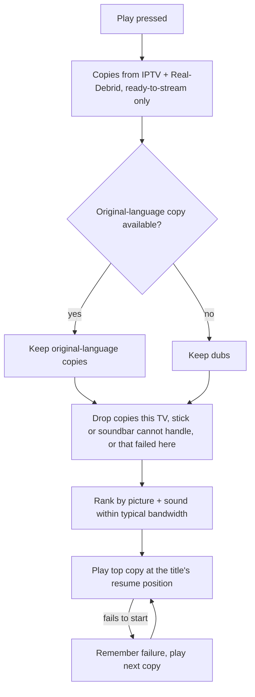

# Unified Movies & Shows - Plan

## Goal Capsule

- **Objective:** The Fire TV app is the one place to find and watch any film or show. It surfaces what is worth watching by scores the owner trusts, and it plays the best copy the current TV, stick and soundbar can handle, from IPTV or Real-Debrid, automatically, with a manual way to see, override and undo every choice.
- **Product authority:** The app's owner and sole user. Live TV and live UFC are not active scope.
- **Open blockers:** None.

---

## Product Contract

### Summary

Movies & Shows becomes a title-first library built from TMDB, with rows ordered by a conviction score and fed by the owner's Trakt and Letterboxd history. Pressing Play gathers copies from the IPTV provider and Real-Debrid and plays the best one for the current setup. It steps down when the connection fails and offers a better copy once the connection recovers. The Options panel shows why each copy was chosen and lets the owner override it.

### Problem Frame

Films and shows live in two apps. The IPTV app has its own catalogue, but its copies are uneven: the "TOP MOVIES BLURAY" copy of Eternal Sunshine measured 1080p H.264 at 3.9 Mbps with stereo AAC. Its rows follow provider categories (4K groups, Blu-ray), not whether a film is any good. Nuvio and Stremio show a separate library backed by Real-Debrid, which often has far better copies (4K HDR or Dolby Vision, Atmos), but no live TV. Choosing what to watch means checking both apps and judging quality by hand.

The setup also changes: an LG OLED with Dolby Vision is planned, and the Sonos Beam Gen 2 sits behind the TV over eARC. A copy that is "best" on paper is wrong if this TV, stick or soundbar cannot show or play it, or if the Wi-Fi cannot carry it.

### Key Decisions

- **Real-Debrid adds titles as well as upgrading copies.** Any film or show can appear, whether or not the provider has it. Governs R15. (session-settled: user-directed — chosen over upgrade-only, which kept the IPTV catalogue and used Real-Debrid only to replace copies: one place to find anything.)
- **Title-first library.** Rows come from TMDB and the owner's history, and the source is resolved only at play. Governs R15, R17, R19. (session-settled: user-directed — chosen over keeping today's rows with any-title search, and over Real-Debrid-first with IPTV filling gaps: closest to an all-in-one app.)
- **Original language first, then quality.** Dubs are only a fallback. Governs R2. (session-settled: user-directed — chosen over English-first and pure-quality ranking.)
- **"Best" means best for the current setup.** The ranking uses what the TV, stick and soundbar report, plus measured bandwidth. Governs R3, R4, R5. (session-settled: user-directed — the owner asked that the pick adapt by itself when the TV, stick or soundbar change.)
- **Automatic by default, with manual control of everything.** Governs R11, R12, R13, R14. (session-settled: user-directed — chosen over a fully hidden source and over a copies list on the title page: the app can measure or choose wrong, so every choice must be visible and reversible.)
- **Step down by itself, never step up by itself; offer the upgrade once.** Governs R9, R10. (session-settled: user-directed — chosen over never switching and over switching both ways automatically: a film that plays fine is never interrupted, and recovered bandwidth is not wasted.)
- **Language rows are English, Arabic, Russian, then everything else; scores order the rows within them.** Governs R17, R18. (session-settled: user-directed — chosen over Arabic plus Spanish, German and Italian: the owner watches mostly English and cares about reviews more than language.)
- **Scores come from official APIs; scraping is a bonus.** A TrueScore-style conviction score is computed from Trakt's rating distribution, with MDBList's Letterboxd and IMDb averages as the fallback. Scraped IMDb and Letterboxd histograms are tried, not relied on. Governs R22, R23, R24, R25. (session-settled: user-approved — proposed after the owner judged Letterboxd and IMDb scraping unlikely to work from the box: both APIs take free keys.)
- **Reviews show scores, rank rows, use the owner's history, and sync back.** Governs R18, R23, R26, R27. (session-settled: user-directed — the owner picked all four uses.)
- **Trakt is the record of what has been watched.** Letterboxd offers no write access, so only Trakt receives what the app logs. Governs R8, R27.
- **One plan, built in three stages.** Best copy first, because it is the largest quality win and it proves Real-Debrid works from this setup. The library and scores come second, and history third. (session-settled: user-directed — chosen over planning only best-copy playback now, and over starting with the library.)

### Stages

| Stage | Delivers | Requirements |
|---|---|---|
| 1. Best copy | Sources, setup-aware picking, stall handling, manual control, title-keyed resume | R1–R14 |
| 2. Library and scores | TMDB title-first rows, language rows, search, conviction scores | R15–R25 |
| 3. History | Trakt and Letterboxd history, Watchlist, recommendations, sync back | R26–R27 |

Stage 1 works on the current library: the copies for a provider title are gathered through its TMDB id. Stage 2 then builds the rows on the same title ids.

### Requirements

**Sources and picking (stage 1)**

- R1. Each play of a film or episode gathers that title's copies from the IPTV provider and from Real-Debrid. A Real-Debrid copy counts only if it is ready to stream immediately.
- R2. Copies in the title's original language are preferred. Dubbed copies are considered only when no original-language copy can play.
- R3. Eligible copies are ranked by picture and sound, counting only what the current TV, stick and soundbar report they support: resolution, HDR type, video codec, audio format and channel count.
- R4. The ranking uses the typical bandwidth from recent measurements, never a single reading. A copy heavier than that bandwidth ranks below one that fits.
- R5. Replacing the TV, stick or soundbar changes the next pick with no settings change.
- R6. When a copy fails to start, the next copy plays without asking. The failure is remembered for this setup, and that copy is skipped on later plays.
- R7. Films and episodes play with a large buffer, so short bandwidth dips do not stall playback.
- R8. Resume position and watched marks belong to the title, not the copy or the source, so switching copy keeps the place. Marks saved today under provider ids carry over.

**Mid-film changes (stage 1)**

- R9. After repeated stalls mid-film, the app switches to the next lighter copy at the same position. It never switches to a better copy by itself.
- R10. When the current copy was limited by bandwidth (picked that way or stepped down), and bandwidth then stays above a better copy's needs with margin for several minutes, a small notice offers that copy once. The notice does not pause or cover the film.
  - Yes switches to that copy at the same position.
  - No, or ignoring the notice until it fades, ends offers for the rest of that film.
  - No offer appears in the last ~15 minutes or during the credits.

**Manual control (stage 1)**

- R11. The Options panel lists every copy with its source, quality labels and picture tier. Choosing one switches to it at the same position.
- R12. The Options panel explains the pick: the capabilities the setup reported, the typical bandwidth used, and why each other copy ranked lower or was ruled out.
- R13. The owner can undo the app's judgements: clear a "failed on this setup" mark, and reverse an automatic step-down.
- R14. The owner can correct a wrong reading, for example that the soundbar does accept TrueHD, or that the bandwidth limit should be ignored. A correction applies to the setup it was made on and lasts until cleared; a new TV or soundbar starts without it.

**Library and search (stage 2)**

- R15. Movies & Shows is built title-first from TMDB. Any film or show can appear, whether or not the IPTV provider has it.
- R16. Up next (Continue watching) stays at the top of Movies & Shows.
- R17. Rows cover trending, new releases, genres, and original language in this order: English, Arabic, Russian, then everything else.
- R18. Within each row, titles are ordered by conviction score, so poorly reviewed titles sink.
- R19. The 4K and Blu-ray rows are removed. Each card shows the picture tier of the best copy known for that title.
- R20. Search matches titles and categories such as a genre or language ("Arabic", "comedy").
- R21. A title with no playable copy stays in its rows, and its page says it is unavailable.

**Scores (stage 2)**

- R22. Each film, show and episode gets a conviction score using TrueScore's net-conviction formula on Trakt's 1–10 rating distribution.
- R23. When a title's Trakt sample is too thin, its score falls back to MDBList's Letterboxd and IMDb averages.
- R24. Cards and title pages show the conviction score, plus the Letterboxd and IMDb averages, next to the quality chip.
- R25. Scraped IMDb and Letterboxd rating histograms are tried as a stronger input. When scraping is blocked, scores and rows still work from R22 and R23.

**History (stage 3)**

- R26. Watched marks, a Watchlist row and recommendations come from the owner's Trakt account and Letterboxd diary. Recommendations draw on what the owner rated highly.
- R27. Films and episodes the owner finishes in the app are logged to Trakt automatically.

### Key Flows

- F1. Press Play
  - **Trigger:** The owner presses Play or Resume on a film or episode.
  - **Steps:** Gather copies from both sources (R1) → keep original-language copies (R2) → drop copies the setup cannot show or play, or that failed here before (R3, R6) → rank the rest against typical bandwidth (R4) → play the top copy at the title's resume position (R8) → if it fails to start, play the next (R6).
  - **Outcome:** The film plays on the best copy this setup can handle, and the Options panel can explain why (R12).

- F2. Bandwidth drops and recovers mid-film
  - **Trigger:** Stalls repeat while a film plays.
  - **Steps:** Step down to the next lighter copy at the same position (R9) → bandwidth recovers and holds → one notice offers the better copy (R10) → Yes switches back; No or no answer ends offers for this film.
  - **Outcome:** The film keeps playing through the drop, and the owner decides whether to go back up.

- F3. The app chose wrong
  - **Trigger:** The owner thinks the pick is wrong (subtitles out of sync, wrong cut, a format the setup really does support).
  - **Steps:** Open Options → read why this copy was chosen (R12) → pick another copy (R11), undo a judgement (R13), or correct a reading (R14).
  - **Outcome:** The film plays on the owner's choice, and corrections shape later picks on this setup.

### Acceptance Examples

- AE1. **Covers R3.** **Given** the current TV reports HDR10 but not Dolby Vision, and the copies are a 4K Dolby Vision remux, a 4K HDR10 WEB-DL and a 1080p IPTV copy, **when** the owner presses Play, **then** the 4K HDR10 copy plays.
- AE2. **Covers R5.** **Given** the TV is replaced by an LG OLED that reports Dolby Vision, **when** the owner plays the same film, **then** the Dolby Vision copy plays, with no setting changed.
- AE3. **Covers R4.** **Given** recent sessions put typical bandwidth around 40 Mbps, and the copies are a 75 Mbps remux and a 25 Mbps WEB-DL, **when** the owner presses Play during a momentary dip to 10 Mbps, **then** the 25 Mbps copy plays.
- AE4. **Covers R2.** **Given** an Arabic-language film whose only copies are an Arabic 1080p IPTV copy and a 4K French dub, **when** the owner presses Play, **then** the Arabic 1080p copy plays.
- AE5. **Covers R9, R10.** **Given** a film stepped down after repeated stalls, and bandwidth back above the original copy's needs for several minutes, **when** the notice appears and the owner ignores it, **then** it fades, and no further offer appears for that film.
- AE6. **Covers R10.** **Given** the same recovery, but with 10 minutes of the film left, **then** no offer appears.
- AE7. **Covers R14.** **Given** the soundbar link reports no TrueHD, **when** the owner corrects it to "accepts TrueHD", **then** TrueHD copies become eligible on this setup. A different soundbar starts without the correction.
- AE8. **Covers R8.** **Given** the owner stopped a film 40 minutes in on an IPTV copy, **when** they resume and the pick is now a Real-Debrid copy, **then** playback starts at 40 minutes.

### Success Criteria

- For titles both sources carry, the copy that plays is never in a lower picture tier than the best IPTV copy the setup can handle.
- Films the owner would have opened Nuvio or Stremio for are found and played in this app instead.
- Playing a Real-Debrid copy leaves the IPTV account's one connection free for the nightly quality probe or for live TV.

### Scope Boundaries

- Live TV, live UFC and the TiviMate playlist do not change.
- Deferred: UFC replays sourced from Real-Debrid.
- Out: Real-Debrid copies that are not ready to stream immediately (anything that would need downloading first).
- Out: writing to Letterboxd. Its diary is read-only here.
- Out: switching to a better copy mid-film without the owner's yes.
- Retiring Nuvio and Stremio is the owner's choice, outside this plan.

### Dependencies / Assumptions

- The owner's existing Real-Debrid account, the one Nuvio and Stremio use.
- Free API keys for TMDB, Trakt and MDBList, plus the owner's Letterboxd username. All of these go in the box's `.env`, never in chat or the repo.
- Assumption: MDBList's free tier (about 1,000 lookups a day) is enough once scores are cached.
- Assumption: Fire OS reports display, decoder and HDMI audio capabilities well enough to rank on. Where it reports them wrongly, R14 covers it.
- 173,128 of the 183,901 provider films (94%) carry a TMDB id. That is the join between the two sources for titles the provider has.

### Outstanding Questions

**Deferred to Planning**

- Does Real-Debrid accept requests from the Hetzner box's datacenter IP? If not, the stick talks to Real-Debrid directly. Check this first in stage 1.
- How are Real-Debrid copies found for a title? Candidates include a Stremio-addon-style lookup by IMDb id after mapping from TMDB, or an own torrent search.
- How are episodes matched inside Real-Debrid season packs?
- The exact thresholds: how many stalls trigger a step-down, how much margin and how many minutes trigger an offer, and the window behind "typical bandwidth".
- How does Fire OS's own audio output setting ("Best available" vs "Dolby Digital Plus") affect the formats the app sees?
- How thin is "too thin" for a Trakt sample (R23)?
- Can IMDb and Letterboxd histograms be fetched from the box at all (R25)?
- Which remote key accepts the upgrade offer without being pressed by accident (R10)?
- How do existing resume and watched marks move from provider ids to title ids (R8)?

### Sources / Research

- `api/_lib.ts:793-803`: the VOD catalogue row carries the provider's TMDB id. `searchVod` (`api/_vod.ts:82-118`) and the Kotlin `Movie` drop it today.
- `api/_shows.ts:21,80`: shows carry a TMDB id, used for de-duplication only.
- `api/_quality-labels.ts:79-85`: `pictureTier` (Reference / Great / OK / Soft), the existing quality scale.
- `api/app.ts:91` with `api/_shows.ts:182-190`: first-play film measurement stored in `.cache/vod-measured.json`.
- `firetv/app/src/main/java/com/mohamed3on/iptv/data/Movies.kt:165,201`: `ResumeStore` and `WatchedStore` are keyed by provider stream and series ids.
- `firetv/app/src/main/java/com/mohamed3on/iptv/player/FrameRate.kt:120-129`: the app already reads the TV's supported display modes.
- `../truescore/PRODUCT.md` and `../truescore/packages/extension/src/sites/imdb.ts`, `letterboxd.ts`: the net-conviction formula `(5★ − 1★) × ((5★ − 1★) / total)`, as applied to IMDb and Letterboxd histograms.
- `docs/plans/2026-11-01-1910-feat-firetv-player-app-plan.md`: the Fire TV app plan this extends.
- Trakt API rating endpoints return a 1–10 `distribution` per movie, show and episode. MDBList's API returns Letterboxd, IMDb, Trakt, TMDB, Rotten Tomatoes and Metacritic scores per title.
